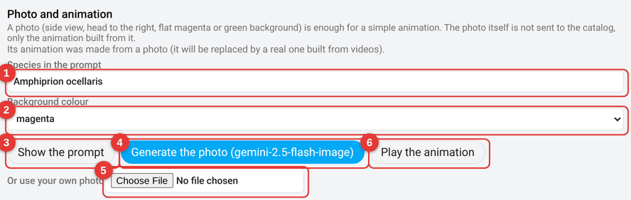
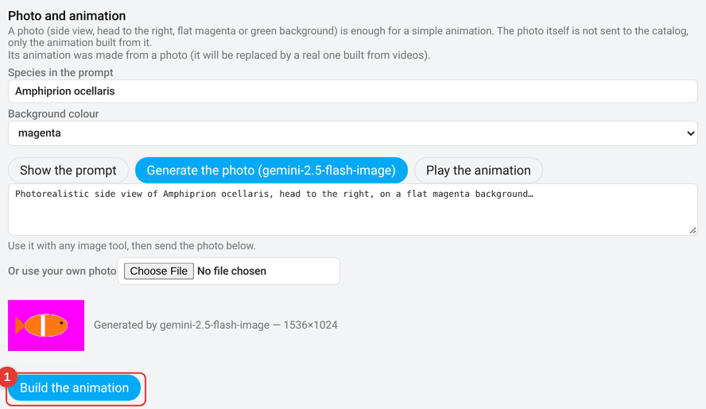

# Benutzerhandbuch — Katalog-Editor

[English](guide.en.md) · [Français](guide.fr.md) · **Deutsch** · [Español](guide.es.md) · [Italiano](guide.it.md) · [Nederlands](guide.nl.md) · [Polski](guide.pl.md) · [Português](guide.pt.md)

Der Katalog-Editor ist eine Home-Assistant-Karte, mit der Sie die Einträge der ReefTech-Kataloge (Ausrüstung, Zusätze …), der Haus-Ansicht (Bäume, Objekte) und von ReefTank (Fische, Korallen, Pflanzen, Wirbellose) **ansehen, bearbeiten und anlegen** und anschließend der Community **vorschlagen** können.

## 1. Wofür ist der Editor da?

Stellen Sie sich einen Karteikasten vor: eine Karte pro Heizer, Zusatz, Fisch oder Baum. Der Editor ist die Karte, mit der Sie diese Einträge lesen, einen korrigieren oder einen neuen hinzufügen – direkt im Dashboard, ohne eine Datei anzufassen.

Drei Dinge, die Sie sich merken sollten:

1. **Was Sie speichern, ist sofort bei Ihnen nutzbar**: Der Eintrag landet in Ihrer „Benutzerebene“, die alle Integrationen teilen, die den Katalog lesen.
2. **Der Vorschlag an den Katalog ist ein zusätzlicher, optionaler Schritt**: Der Editor öffnet für Sie auf GitHub einen *Pull Request* (eine Anfrage zur Aufnahme), damit Ihr Eintrag allen nützt.
3. **Der Editor prüft Ihre Einträge** mit denselben Regeln wie der Katalog: Meldet er „Alles in Ordnung“, wird der Eintrag akzeptiert.

## 2. Bevor Sie anfangen

### Karte installieren und hinzufügen

1. Installieren Sie die Integration *Catalog editor* (HACS-Custom-Repository oder Ordner `custom_components/catalog_editor` kopieren) und fügen Sie sie unter *Einstellungen → Geräte & Dienste* hinzu.
2. Die Integration fragt nach der **Client-ID einer GitHub-OAuth-App** (siehe unten) und nach den **Katalogen, die Sie abonnieren** (Ausrüstung, Zusätze, Parameter, Wassertests, Bäume, Objekte und die ReefTank-Arten: Fische, Korallen, Pflanzen, Wirbellose). Standardmäßig ist alles angehakt; später änderbar unter *Konfigurieren*.
3. Fügen Sie auf einem Dashboard eine manuelle Karte mit diesem Code hinzu:

```yaml
type: custom:catalog-editor-card
```

Die Integration liefert die Karte selbst aus: Bei den Ressourcen ist nichts zu ergänzen. Sie erscheint je nach Sprache von Home Assistant auf Französisch oder Englisch.

### Die GitHub-App anlegen (einmalig, 1 Minute)

Dieser Schritt ist nur nötig, wenn Sie Einträge dem Katalog **vorschlagen** wollen. Zum Bearbeiten bei sich zu Hause können Sie ihn überspringen.

1. Öffnen Sie <https://github.com/settings/applications/new> (bei GitHub angemeldet).
2. *Application name*: beliebig, z. B. `Catalog editor`. *Homepage URL* und *Authorization callback URL*: beliebige Adresse, z. B. `https://github.com/Elwinmage/catalog-editor` (werden nicht benutzt).
3. Haken bei **Enable Device Flow**, dann **Register application**.
4. Kopieren Sie die **Client ID** der nächsten Seite in die Integration. Ein Secret ist nicht nötig.

## 3. Erster Start: einen Katalog herunterladen

Beim ersten Mal ist ein Katalog noch nicht auf Ihrem Home Assistant. Die Karte sagt es: *„Dieser Katalog ist noch nicht heruntergeladen“*.


1. Klicken Sie auf **Download** (1): Die Karte holt die zuletzt veröffentlichte Version des Katalogs.
2. Um den Katalog zu wechseln, öffnen Sie oben die **Dropdown-Liste** (2). Hinter jedem Namen steht seine Familie: *(reeftech)*, *(reeftank)* oder *(house view)*.

Der heruntergeladene Katalog wird mit den anderen installierten Integrationen geteilt: ein Download für alle. Später holt **Check for updates** eine neuere Version.

> Fehlt ein Katalog in der Liste, haben Sie ihn nicht abonniert. Fügen Sie ihn unter *Konfigurieren* der Integration hinzu.

## 4. Rundgang über den Bildschirm

Das ist der Startbildschirm. Die roten Markierungen entsprechen der Liste unten.


1. **Der Katalog**: Die Dropdown-Liste wählt den Katalog, den Sie ansehen.
2. **Die Art des Eintrags**: Ein Katalog enthält mehrere (hier Items, Categories, Tasks).
3. **Die Suche**: Tippen Sie ein paar Buchstaben, die Liste wird sofort kleiner.
4. **+ New**: legt einen leeren Eintrag an.
5. **Check for updates**: holt eine neue Version des Katalogs.

Unter der Liste betreffen zwei Bereiche GitHub: die **Anmeldung** und Ihre **Pull Requests** (Abschnitte 8 und 9). Jede Zeile trägt ein Label: *catalog* für einen offiziellen Eintrag, *yours* für einen bei Ihnen gespeicherten.

## 5. Einen Eintrag finden

- **Per Suche**: Tippen Sie einen Teil des Namens oder der Kennung. Passt nichts, zeigt die Karte „Nothing here yet“.
- **Nach Marke**: Im Ausrüstungskatalog sind die Einträge gruppiert (Eheim, Tunze, ohne Marke …). Klicken Sie auf den Pfeil einer Gruppe, um sie zu öffnen.
- **Nach Wasserart**: In den ReefTank-Artenkatalogen — **Fische, Korallen, Pflanzen und Wirbellose** — filtern Schaltflächen die Liste: *All waters*, *Marine*, *Freshwater*, *Brackish*. Die Zahl in Klammern ist die Anzahl der Einträge.


Pflanzen und Wirbellose finden Sie genauso:


Zum Öffnen eines Eintrags klicken Sie einfach auf seine Zeile.

## 6. Einen Eintrag bearbeiten oder anlegen

Das Formular wird aus den Regeln des Katalogs erzeugt: Ein neues Feld im Katalog erscheint hier ohne Update der Karte.

- Felder mit einem **roten Stern** sind Pflicht.
- Bei einem Eintrag **aus dem Katalog** weist ein Banner darauf hin, dass das Speichern **Ihre eigene Version** anlegt: Das Original wird nie verändert.
- **Kennung (Identifier)**: wird vorgeschlagen (Kleinbuchstaben, Ziffern, `-` und `_`). Bei einer Art ist es der wissenschaftliche Name (`gattung_art`). Sie können sie korrigieren.
- **Namen in mehreren Sprachen**: Füllen Sie mindestens Englisch aus. *Other languages* klappt die übrigen auf; **Translate** füllt fehlende Sprachen für Sie.
- **Kästchen und Listen**: Wasserarten, Riff-Verträglichkeit … je nach Eintrag. Eine Farbe (Bäume, Objekte) wählen Sie mit dem Farbwähler oder tippen sie als `#rrggbb`.

Unter dem Formular zeigt eine Meldung den Zustand des Eintrags: **„Everything checks out“** in Grün oder die Liste dessen, was zu korrigieren ist. Solange ein Fehler besteht, sind die Speichern-Schaltflächen ausgegraut.

### Was sich je nach Katalog ändert

| Katalog | Bild des Eintrags |
| --- | --- |
| Ausrüstung, Zusätze, Parameter, Wassertests, Bäume, Objekte | Ein Block **Image** erlaubt das Hochladen eines Bildes (wird in transparentes WebP umgewandelt) |
| **Fische** | Kein Bild hochzuladen: Sie bauen eine **Animation** (Abschnitt 7) |
| **Korallen, Pflanzen, Wirbellose** | Der Editor bearbeitet die **Beschreibung** der Art. Ihre Bilder entstehen mit den Werkzeugen des ReefTank-Katalogs (siehe dessen README): dieses Formular hat keinen Foto-Block |


## 7. Fische: Foto und Animation

Im Aquarium von ha-reef-card kann ein Fisch in **drei Darstellungsstufen** gezeigt werden. Das ist der Schlüssel zum Verständnis des Editors:

| Stufe | Was Sie sehen | Woher es kommt |
| --- | --- | --- |
| **1. Generischer Fisch** | Ein Allzweck-Fisch, derselbe für alle betroffenen Arten | Kein Bild im Eintrag: Das ist der Standard des Katalogs (`unknown_fish`) |
| **2. Animation aus einem Foto** („degraded“) | Der echte Fisch mit einer einfachen Animation: schwimmen, ruhen, wenden | **Vom Editor gebaut** aus einem Foto (KI-generiert oder Ihr eigenes) |
| **3. Animation aus Videos** („real“) | Der echte Fisch mit flüssiger, natürlicher Animation | **Außerhalb des Editors** mit den Werkzeugen des ReefTank-Katalogs aus kurzen Videoclips gebaut (Kling, Veo …) |

Der Editor führt eine Art also schnell und ohne Video von Stufe 1 zu Stufe 2. Stufe 3 bleibt das Endziel: Wenn sie existiert, **wird sie nie ersetzt** durch eine Animation aus einem Foto – es sei denn, Sie haken *„Use it anyway (ignore the checks)“* an. Umgekehrt ist eine Animation der Stufe 2 dafür gedacht, eines Tages durch eine echte ersetzt zu werden.

Der Block *Photo and animation* zeigt immer den Stand: *„This species has no picture yet“* (Stufe 1), *„Its animation was made from a photo…“* (Stufe 2) oder *„Its animation was made from videos: a photo does not replace it“* (Stufe 3).

### Schritt 1 — Das Foto vorbereiten

Der Block *Photo and animation* steht unter dem Artenformular. Die roten Markierungen entsprechen:



1. **Species in the prompt**: der wissenschaftliche Name, mit dem das Bild angefordert wird (für Sie ausgefüllt).
2. **Background colour**: Magenta oder Grün. Wählen Sie die Farbe, die sich am stärksten von der Art abhebt (kein Magenta für einen rosa Fisch).
3. **Show the prompt**: zeigt den genauen Text, der gesendet wird, damit Sie ihn in einem anderen Bildwerkzeug verwenden können.
4. **Generate the photo**: fordert das Bild bei Ihrem KI-Anbieter an. Wählen Sie zuerst den Anbieter (Google Gemini, OpenAI oder Cloudflare Workers AI) und tragen Sie **Ihren eigenen API-Schlüssel** in den *Optionen* der Integration ein. Der Schlüssel bleibt in Home Assistant und wird nie an die Karte zurückgesendet. Ohne Schlüssel erscheint diese Schaltfläche nicht.
5. **Ihr eigenes Foto**: Sie können auch eine Datei hochladen (PNG, JPEG oder WebP). Geben Sie dann Urheber und Lizenz an.
6. **Play the animation**: öffnet die Vorschau (Schritt 3). Die Schaltfläche erscheint nur, wenn der Eintrag schon eine Animation hat oder Sie gerade eine gebaut haben.

Das Foto muss **einen einzelnen Fisch von der Seite, Kopf nach rechts**, auf einfarbigem Hintergrund zeigen.

### Schritt 2 — Das Foto prüfen und die Animation bauen

Nach der Erzeugung erscheint das Foto als Miniatur mit seiner Herkunft (Modell, Größe). Der Editor **prüft** es: einfarbiger Hintergrund, ganzer Fisch ohne Anschnitt am Rand, ausreichende Größe. Wird es abgelehnt, nennt die Karte den Grund: neu generieren oder die Hintergrundfarbe wechseln.



Wird das Foto akzeptiert, klicken Sie auf **Build the animation**. Die Meldung *„Animation ready: it is attached when you save the entry“* bestätigt, dass alles passt.

### Schritt 3 — Die Animation ansehen

**Play the animation** öffnet neben dem Formular ein Panel. Es spielt vier Sequenzen in einer Schleife: **stay** (ruhen), **swim** (schwimmen), **turn** (wenden) und dann die Wende **gespiegelt**, damit der Fisch wieder in seine Ausgangsrichtung schaut. Der Name der laufenden Sequenz steht über dem Fisch. *Close* schließt das Panel.

Mit der Liste **Background** beurteilen Sie das Ergebnis auf drei Hintergründen: **Water**, **Dark** und **Light**.


> Die Screenshots dieses Handbuchs zeigen einen Beispiel-Fisch: Die echte Animation folgt dem Foto Ihrer Art.

## 8. Speichern und dem Katalog vorschlagen

### Bei sich speichern

**Save** legt den Eintrag in Ihre Benutzerebene, die alle Integrationen teilen: Er ist **sofort** nutzbar, ohne auf ein Release zu warten. Bei einem Katalogeintrag ist es eine lokale Kopie (ein *Override*): Sie behält das Originalbild, bis Sie ein neues hochladen.

### Mit GitHub verbinden (einmalig)

1. Klicken Sie im GitHub-Bereich auf **Connect to GitHub**.
2. Die Karte zeigt einen **Code** (etwa `ABCD-1234`) und eine GitHub-Adresse.
3. Öffnen Sie die Adresse, geben Sie den Code ein und bestätigen Sie.
4. Die Karte erkennt die Verbindung selbst und zeigt *„Connected as …“*.


Der Editor verlangt nur die Berechtigung `public_repo`: Er forkt den Katalog, pusht einen Branch und öffnet den Pull Request. Das Token bleibt in Home Assistant gespeichert. **Disconnect** löscht es.

### Vorschlagen

1. Prüfen Sie, dass die Meldung **„Everything checks out“** lautet.
2. Haken Sie das **Zertifizierungs**-Kästchen an: Sie erklären, dass jedes Bild Ihr eigenes Werk ist (oder Sie die Rechte besitzen), und stimmen der Veröffentlichung unter CC BY 4.0 zu.
3. Klicken Sie auf **Save and propose to the catalog**. Die Schaltfläche bleibt ausgegraut, solange Sie nicht verbunden sind, der Eintrag einen Fehler hat oder das Kästchen nicht angehakt ist.


Die Karte zeigt dann die Nummer des geöffneten Pull Requests. Speichern Sie erneut, solange er offen ist, wird ein weiterer Commit hinzugefügt. Bei einem Fisch enthält die Anfrage die Animation und ihr Vorschaubild, **nie das Foto**.

**Propose all my entries** schickt alle lokalen, noch nicht vorgeschlagenen Einträge auf einmal. Gehören sie zu mehreren Katalogen, wird pro Repository ein Pull Request geöffnet.

## 9. Ihre Pull Requests verfolgen

Unten in der Karte listet **Your pull requests** auf, was Sie vorgeschlagen haben. Vier Schaltflächen filtern die Liste (die Zahl zeigt die Anzahl der Anfragen):


| Filter | Was er zeigt |
| --- | --- |
| Open | Anfragen, die auf Prüfung warten (Standardansicht) |
| Merged | Akzeptiert, aber noch nicht in einer veröffentlichten Version des Katalogs |
| In the catalog | Akzeptiert und in einer Version veröffentlicht |
| All | Alles, auch abgelehnte Anfragen (mit einem Badge markiert) |

Klicken Sie auf die Nummer einer Anfrage, um sie auf GitHub zu öffnen. **Refresh** lädt die Liste neu.

Sobald Ihre Anfrage gemerged **und** veröffentlicht ist, wird Ihre lokale Kopie automatisch entfernt, wenn sie mit dem Katalogeintrag identisch ist. Sonst bleibt sie: Löschen Sie sie von Hand im Eintrag.

## 10. Häufige Fragen

| Symptom | Wahrscheinliche Ursache | Was tun |
| --- | --- | --- |
| Ein Katalog fehlt in der Liste | Nicht abonniert | *Konfigurieren* der Integration, Katalog anhaken (sie lädt neu) |
| Es gibt keine Schaltfläche „Generate the photo“ | Kein Bildanbieter konfiguriert | Anbieter wählen und Schlüssel in den Optionen eintragen; oder eigenes Foto hochladen |
| Das Foto wird abgelehnt | Hintergrund nicht einfarbig, Fisch angeschnitten oder zu klein | Neu generieren oder Hintergrundfarbe wechseln |
| Eine Animation lässt sich nicht ersetzen | Der Eintrag hat schon eine Animation aus Videos (Stufe 3) | Das ist gewollt. *„Use it anyway“* nur anhaken, wenn Sie sicher sind |
| „Save and propose“ ist ausgegraut | Nicht verbunden, Fehler im Eintrag oder Zertifizierung nicht angehakt | Eintrag korrigieren, verbinden, Kästchen anhaken |
| Die GitHub-Anmeldung ist abgelaufen | Token widerrufen oder abgelaufen | Erneut auf *Connect to GitHub* klicken; der laufende Vorschlag wird nach der Anmeldung fortgesetzt |
| Die Karte aktualisiert sich nicht | Browser-Cache | Seite neu laden (Strg+F5); mehrere Aktualisierungen können nötig sein |

Ein gespeicherter Eintrag ist eine **lokale Kopie**: Zum Entfernen öffnen Sie ihn und nutzen die Löschen-Schaltfläche.
