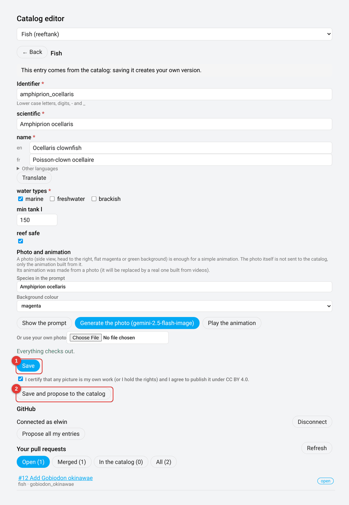

# User guide — Catalog editor

**English** · [Français](guide.fr.md) · [Deutsch](guide.de.md) · [Español](guide.es.md) · [Italiano](guide.it.md) · [Nederlands](guide.nl.md) · [Polski](guide.pl.md) · [Português](guide.pt.md)

The catalog editor is a Home Assistant card that lets you **browse, edit and create** the entries of the ReefTech catalogs (equipment, supplements…), of the house view (trees, objects) and of ReefTank (fish, corals, plants, invertebrates), then **propose** them to the community.

## 1. What is the editor for?

Picture a binder of cards: one card per heater, supplement, fish or tree. The editor is the card that lets you read them, fix one, or add a new one, straight from your dashboard, without touching a file.

Three things to remember:

1. **What you save is usable right away** at home: the entry goes into your "user layer", shared by every integration that reads the catalog.
2. **Proposing it to the catalog is an extra, optional step**: the editor opens a *pull request* (a request to add it) on GitHub for you, so your entry benefits everyone.
3. **The editor checks your entries** with the same rules as the catalog: if it says "Everything checks out", the entry will be accepted.

## 2. Before you start

### Install and add the card

1. Install the *Catalog editor* integration (HACS custom repository, or copy the `custom_components/catalog_editor` folder), then add it in *Settings → Devices & services*.
2. The integration asks for the **client ID of a GitHub OAuth App** (see below) and for the **catalogs to subscribe to** (equipment, supplements, parameters, water tests, trees, objects, and the ReefTank species: fish, corals, plants, invertebrates). Everything is ticked by default; change it later in *Configure*.
3. On a dashboard, add a manual card with this code:

```yaml
type: custom:catalog-editor-card
```

The integration serves the card: there is nothing to add to the resources. It is shown in French or English depending on the language of Home Assistant.

### Create the GitHub app (once, 1 minute)

This step is only needed if you want to **propose** entries to the catalog. To edit at home you can skip it.

1. Open <https://github.com/settings/applications/new> (signed in to GitHub).
2. *Application name*: anything, e.g. `Catalog editor`. *Homepage URL* and *Authorization callback URL*: any address, e.g. `https://github.com/Elwinmage/catalog-editor` (they are not used).
3. Tick **Enable Device Flow**, then **Register application**.
4. Copy the **Client ID** of the next page into the integration. No secret is needed.

## 3. First launch: download a catalog

The first time, a catalog is not on your Home Assistant yet. The card says so: *"This catalog is not downloaded yet"*.


1. Click **Download** (1): the card fetches the latest published version of the catalog.
2. To switch catalog, open the **drop-down list** (2) at the top. Each name is followed by its family: *(reeftech)*, *(reeftank)* or *(house view)*.

The downloaded catalog is shared with the other installed integrations: one download for everybody. Later, **Check for updates** fetches a newer version.

> If a catalog is missing from the list, you are not subscribed to it. Add it in *Configure* on the integration.

## 4. A tour of the screen

This is the home screen. The red badges match the list below.


1. **The catalog**: the drop-down list picks the one you browse.
2. **The kind of entry**: a catalog holds several (here Items, Categories, Tasks).
3. **Search**: type a few letters, the list narrows at once.
4. **+ New**: creates an empty entry.
5. **Check for updates**: fetches a new version of the catalog.

Under the list, two areas concern GitHub: the **connection** and your **pull requests** (sections 8 and 9). Each row carries a label: *catalog* for an official entry, *yours* for an entry you saved at home.

## 5. Find an entry

- **By search**: type part of the name or of the identifier. If nothing matches, the card says "Nothing here yet".
- **By brand**: in the equipment catalog, entries are grouped (Eheim, Tunze, No brand…). Click a group's arrow to open it.
- **By water type**: in the ReefTank species catalogs — **fish, corals, plants and invertebrates** — buttons filter the list: *All waters*, *Marine*, *Freshwater*, *Brackish*. The number in brackets is how many entries it holds.


Plants and invertebrates are found the very same way:


To open an entry, just click its row.

## 6. Edit or create an entry

The form is generated from the rules of the catalog: a field added to the catalog shows up here without updating the card.

- Fields marked with a **red star** are required.
- For an entry **of the catalog**, a banner reminds you that saving it creates **your own version**: the original is never changed.
- **Identifier**: suggested for you (lower case, digits, `-` and `_`). For a species it is the scientific name (`genus_species`). You can correct it.
- **Names in several languages**: fill in at least English. *Other languages* opens the rest; the **Translate** button fills the missing ones for you.
- **Boxes and lists**: water types, reef safe… depending on the entry. A colour (trees, objects) is picked with the selector or typed as `#rrggbb`.

Under the form, a message tells you the state of the entry: **"Everything checks out"** in green, or the list of what to fix. While an error remains, the save buttons are greyed.

### What changes from one catalog to another

| Catalog | Picture of the entry |
| --- | --- |
| Equipment, supplements, parameters, water tests, trees, objects | An **Image** block lets you upload a picture (converted to transparent WebP) |
| **Fish** | No picture to upload: you build an **animation** (section 7) |
| **Corals, plants, invertebrates** | The editor edits the **description** of the species. Its pictures are built with the tools of the ReefTank catalog (see its README): this form has no photo block |


## 7. Fish: photo and animation

In the aquarium of ha-reef-card, a fish can be drawn at **three levels of rendering**. This is the key to what the editor does:

| Level | What you see | Where it comes from |
| --- | --- | --- |
| **1. Generic fish** | An all-purpose fish, the same for every species concerned | No picture in the entry: this is the default of the catalog (`unknown_fish`) |
| **2. Animation from a photo** ("degraded") | The real fish, with a simple animation: swim, idle, turn | **Built by the editor** from a photo (AI-generated or your own) |
| **3. Animation from videos** ("real") | The real fish, with a smooth, natural animation | Built **outside the editor**, with the tools of the ReefTank catalog, from short video clips (Kling, Veo…) |

The editor therefore takes a species from level 1 to level 2, quickly and without any video. Level 3 remains the end goal: when it exists, **it is never replaced** by an animation made from a photo, unless you tick *"Use it anyway (ignore the checks)"*. Conversely, a level 2 animation is meant to be replaced by a real one one day.

The *Photo and animation* block always tells you where the entry stands: *"This species has no picture yet"* (level 1), *"Its animation was made from a photo…"* (level 2) or *"Its animation was made from videos: a photo does not replace it"* (level 3).

### Step 1 — Prepare the photo

The *Photo and animation* block sits under the species form. The red badges match:


1. **Species in the prompt**: the scientific name used to ask for the picture (filled in for you).
2. **Background colour**: magenta or green. Pick the one that contrasts most with the species (no magenta for a pink fish).
3. **Show the prompt**: shows the exact text that will be sent, so you can paste it in any other image tool.
4. **Generate the photo**: asks your AI provider for the picture. First choose the provider (Google Gemini, OpenAI or Cloudflare Workers AI) and enter **your own API key** in the integration's *Options*. The key stays in Home Assistant and is never sent back to the card. Without a key, this button does not appear.
5. **Your own photo**: you can also upload a file (PNG, JPEG or WebP). Then give its author and licence.
6. **Play the animation**: opens the preview (step 3). This button only appears if the entry already has an animation or you have just built one.

The photo must show **a single fish, from the side, head to the right**, on a flat background.

### Step 2 — Check the photo and build the animation

Once generated, the photo is shown as a thumbnail with its origin (model used, size). The editor **checks** it: flat background, whole fish not cut by the edge, large enough. If it is refused, the card says why: generate again or change the background colour.


If the photo is accepted, click **Build the animation**. The message *"Animation ready: it is attached when you save the entry"* confirms all is well.

### Step 3 — Watch the animation

**Play the animation** opens a panel beside the form. It loops four sequences: **stay**, **swim**, **turn**, then the turn **mirrored** so the fish ends up facing the way it started. The name of the current sequence is shown above the fish. *Close* closes the panel.

The **Background** list lets you judge the result on three backgrounds: **Water**, **Dark** and **Light**.


> The screenshots of this guide show a fish drawn for the example: the real animation follows the photo of your species.

## 8. Save and propose to the catalog

### Save at home

**Save** puts the entry in your user layer, shared by every integration: it is usable **right away**, without waiting for a release. For an entry of the catalog it is a local copy (an *override*): it keeps the original picture until you upload a new one.

### Connect to GitHub (once)

1. Click **Connect to GitHub** in the GitHub area.
2. The card shows a **code** (like `ABCD-1234`) and a GitHub address.
3. Open the address, type the code and confirm.
4. The card notices the connection by itself and shows *"Connected as …"*.


The editor only asks for the `public_repo` permission: it forks the catalog, pushes a branch and opens the pull request. The token stays stored in Home Assistant. **Disconnect** erases it.

### Propose

1. Check that the message says **"Everything checks out"**.
2. Tick the **certification** box: you state that any picture is your own work (or that you hold the rights) and agree to publish it under CC BY 4.0.
3. Click **Save and propose to the catalog**. The button stays greyed while you are not connected, the entry has an error or the box is not ticked.



The card then shows the number of the pull request it opened. If you save again while it is open, a new commit is added to it. For a fish, the request holds the animation and its thumbnail, **never the photo**.

**Propose all my entries** sends all your local entries not yet proposed at once. If they belong to several catalogs, one pull request is opened per repository.

## 9. Follow your pull requests

At the bottom of the card, **Your pull requests** lists what you proposed. Four buttons filter the list (the number tells how many requests each holds):


| Filter | What it shows |
| --- | --- |
| Open | Requests waiting for review (the default view) |
| Merged | Accepted, but not yet in a published version of the catalog |
| In the catalog | Accepted and published in a version |
| All | Everything, including refused requests (marked with a badge) |

Click the number of a request to open it on GitHub. **Refresh** reloads the list.

Once your request is merged **and** released, your local copy is removed automatically when it is identical to the catalog's. Otherwise it stays: delete it by hand from the entry.

## 10. Frequently asked questions

| Symptom | Likely cause | What to do |
| --- | --- | --- |
| A catalog is missing from the list | You are not subscribed to it | *Configure* on the integration, tick it (it reloads) |
| There is no "Generate the photo" button | No image provider configured | Choose a provider and enter your key in the integration's options; or upload your own photo |
| The photo is refused | Background not flat, fish cut or too small | Generate again, or change the background colour |
| An animation cannot be replaced | The entry already has an animation made from videos (level 3) | That is intended. Tick *"Use it anyway"* only if you are sure |
| "Save and propose" is greyed | Not connected, error in the entry or certification not ticked | Fix the entry, connect, tick the box |
| The GitHub login expired | Token revoked or expired | Click *Connect to GitHub* again; the proposal in progress resumes after the login |
| The card does not update | Browser cache | Reload the page (Ctrl+F5); several refreshes may be needed |

An entry you save is a **local copy**: to remove it, open it and use the delete button.
