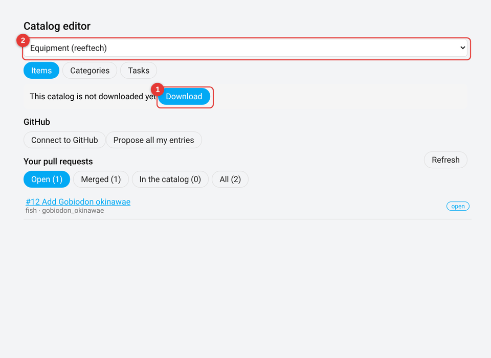
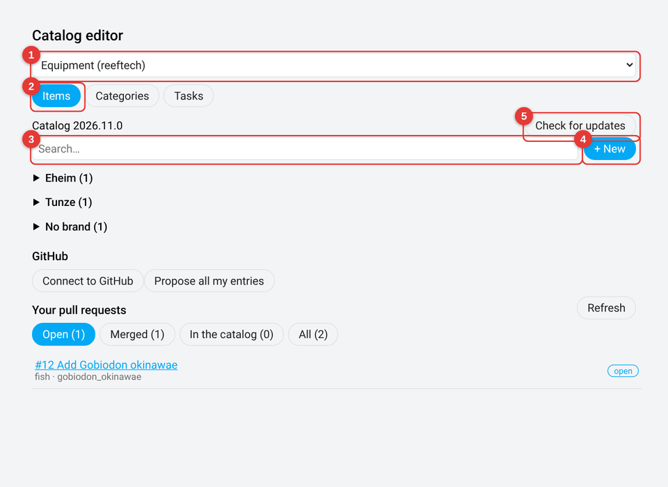
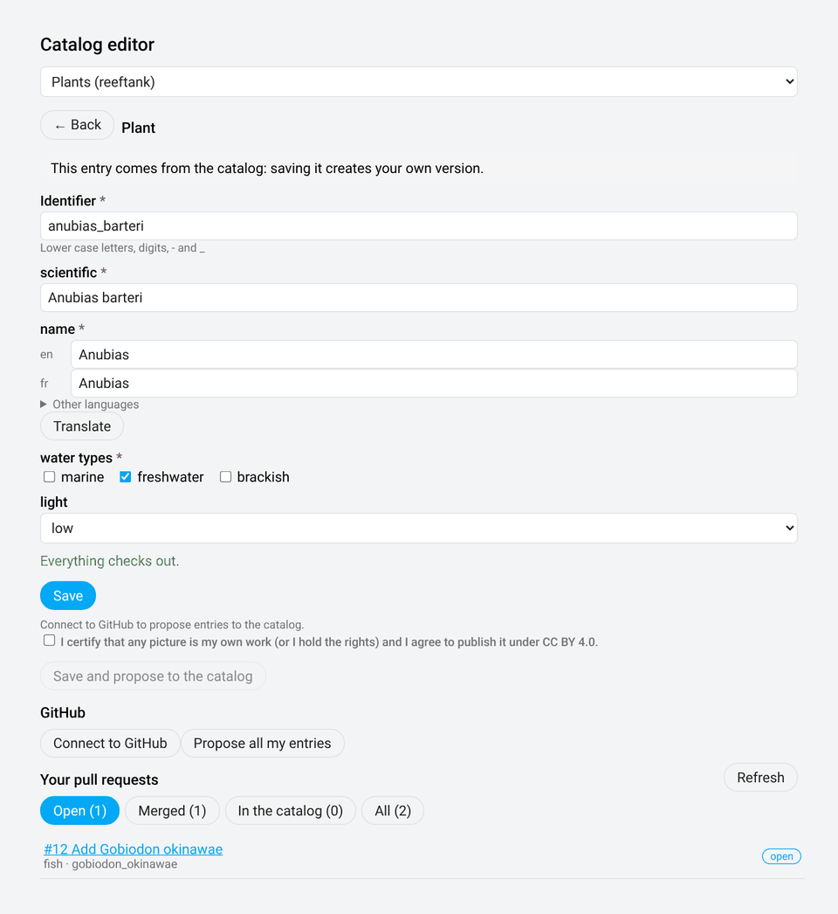
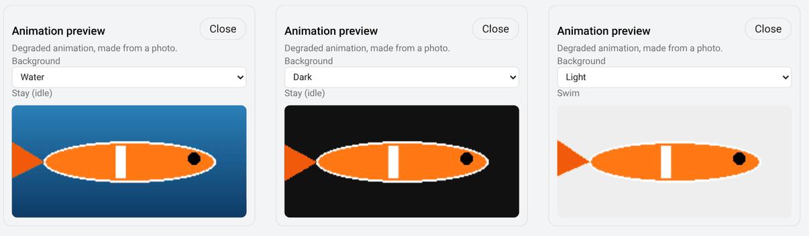

# Guía del usuario — Editor de catálogo

[English](guide.en.md) · [Français](guide.fr.md) · [Deutsch](guide.de.md) · **Español** · [Italiano](guide.it.md) · [Nederlands](guide.nl.md) · [Polski](guide.pl.md) · [Português](guide.pt.md)

El editor de catálogo es una tarjeta de Home Assistant que permite **consultar, modificar y crear** las fichas de los catálogos ReefTech (equipos, suplementos…), de la vista de la casa (árboles, objetos) y de ReefTank (peces, corales, plantas, invertebrados), y después **proponerlas** a la comunidad.

## 1. ¿Para qué sirve el editor?

Imagine un archivador de fichas: una ficha por calentador, suplemento, pez o árbol. El editor es la tarjeta que le permite leer esas fichas, corregir una o añadir una nueva, directamente desde su panel, sin tocar ningún archivo.

Tres ideas que recordar:

1. **Lo que guarda se puede usar enseguida** en su casa: la ficha se guarda en su «capa de usuario», compartida por todas las integraciones que leen el catálogo.
2. **Proponerla al catálogo es un paso adicional y opcional**: el editor abre por usted una *pull request* (una solicitud de incorporación) en GitHub, para que su ficha beneficie a todos.
3. **El editor comprueba sus fichas** con las mismas reglas que el catálogo: si dice «Everything checks out», la ficha será aceptada.

## 2. Antes de empezar

### Instalar y añadir la tarjeta

1. Instale la integración *Catalog editor* (repositorio personalizado de HACS, o copiando la carpeta `custom_components/catalog_editor`) y añádala en *Ajustes → Dispositivos y servicios*.
2. La integración pide el **ID de cliente de una aplicación OAuth de GitHub** (ver abajo) y los **catálogos a los que suscribirse** (equipos, suplementos, parámetros, tests de agua, árboles, objetos y las especies de ReefTank: peces, corales, plantas, invertebrados). Todo viene marcado por defecto; puede cambiarlo después en *Configurar*.
3. En un panel, añada una tarjeta manual con este código:

```yaml
type: custom:catalog-editor-card
```

La integración sirve la tarjeta: no hay nada que añadir a los recursos. Se muestra en francés o en inglés según el idioma de Home Assistant.

### Crear la aplicación de GitHub (una sola vez, 1 minuto)

Este paso solo es necesario si quiere **proponer** fichas al catálogo. Para modificar en su casa puede omitirlo.

1. Abra <https://github.com/settings/applications/new> (con la sesión de GitHub iniciada).
2. *Application name*: lo que quiera, por ejemplo `Catalog editor`. *Homepage URL* y *Authorization callback URL*: cualquier dirección, por ejemplo `https://github.com/Elwinmage/catalog-editor` (no se usan).
3. Marque **Enable Device Flow** y luego **Register application**.
4. Copie el **Client ID** de la página siguiente en la integración. No hace falta ningún secreto.

## 3. Primer inicio: descargar un catálogo

La primera vez, el catálogo aún no está en su Home Assistant. La tarjeta se lo indica: *«This catalog is not downloaded yet»*.



1. Pulse **Download** (1): la tarjeta obtiene la última versión publicada del catálogo.
2. Para cambiar de catálogo, abra la **lista desplegable** (2) de arriba. Cada nombre va seguido de su familia: *(reeftech)*, *(reeftank)* o *(house view)*.

El catálogo descargado se comparte con las demás integraciones instaladas: una sola descarga para todos. Más adelante, **Check for updates** obtiene una versión más reciente.

> Si falta un catálogo en la lista, es que no está suscrito. Añádalo en *Configurar*, en la integración.

## 4. Recorrido por la pantalla

Esta es la pantalla de inicio. Las marcas rojas corresponden a la lista de abajo.



1. **El catálogo**: la lista desplegable elige el que consulta.
2. **El tipo de ficha**: un catálogo contiene varios (aquí Items, Categories, Tasks).
3. **La búsqueda**: escriba unas letras y la lista se reduce al instante.
4. **+ New**: crea una ficha vacía.
5. **Check for updates**: obtiene una nueva versión del catálogo.

Bajo la lista, dos zonas se refieren a GitHub: la **conexión** y sus **pull requests** (secciones 8 y 9). Cada fila lleva una etiqueta: *catalog* para una ficha oficial, *yours* para una ficha guardada en su casa.

## 5. Encontrar una ficha

- **Con la búsqueda**: escriba parte del nombre o del identificador. Si nada coincide, la tarjeta muestra «Nothing here yet».
- **Por marca**: en el catálogo de equipos, las fichas están agrupadas (Eheim, Tunze, sin marca…). Pulse la flecha de un grupo para desplegarlo.
- **Por tipo de agua**: en los catálogos de especies de ReefTank — **peces, corales, plantas e invertebrados** — unos botones filtran la lista: *All waters*, *Marine*, *Freshwater*, *Brackish*. El número entre paréntesis es la cantidad de fichas.


Las plantas y los invertebrados se encuentran exactamente igual:


Para abrir una ficha, pulse simplemente su fila.

## 6. Modificar o crear una ficha

El formulario se genera a partir de las reglas del catálogo: un campo añadido al catálogo aparece aquí sin actualizar la tarjeta.

- Los campos marcados con una **estrella roja** son obligatorios.
- En una ficha **del catálogo**, un aviso recuerda que guardarla crea **su propia versión**: el original nunca se modifica.
- **Identificador**: se propone automáticamente (minúsculas, cifras, `-` y `_`). Para una especie es el nombre científico (`genero_especie`). Puede corregirlo.
- **Nombres en varios idiomas**: rellene al menos el inglés. *Other languages* despliega los demás; el botón **Translate** rellena los que faltan por usted.
- **Casillas y listas**: tipos de agua, compatibilidad con arrecife… según la ficha. Un color (árboles, objetos) se elige con el selector o se escribe como `#rrggbb`.

Bajo el formulario, un mensaje indica el estado de la ficha: **«Everything checks out»** en verde, o la lista de lo que hay que corregir. Mientras quede un error, los botones de guardar aparecen atenuados.

### Lo que cambia según el catálogo

| Catálogo | Imagen de la ficha |
| --- | --- |
| Equipos, suplementos, parámetros, tests de agua, árboles, objetos | Un bloque **Image** permite subir una imagen (convertida a WebP transparente) |
| **Peces** | No hay imagen que subir: se construye una **animación** (sección 7) |
| **Corales, plantas, invertebrados** | El editor modifica la **descripción** de la especie. Sus imágenes se construyen con las herramientas del catálogo ReefTank (vea su README): este formulario no tiene bloque de foto |



## 7. Peces: foto y animación

En el acuario de ha-reef-card, un pez puede mostrarse en **tres niveles de representación**. Es la clave para entender lo que hace el editor:

| Nivel | Lo que se ve | De dónde viene |
| --- | --- | --- |
| **1. Pez genérico** | Un pez comodín, el mismo para todas las especies afectadas | No hay imagen en la ficha: es el valor por defecto del catálogo (`unknown_fish`) |
| **2. Animación a partir de una foto** («degraded») | El pez real, con una animación sencilla: nadar, reposo, giro | **Construida por el editor** a partir de una foto (generada por IA o suya) |
| **3. Animación a partir de vídeos** («real») | El pez real, con una animación fluida y natural | Construida **fuera del editor**, con las herramientas del catálogo ReefTank, a partir de clips de vídeo cortos (Kling, Veo…) |

El editor sirve, pues, para pasar del nivel 1 al nivel 2, rápido y sin vídeo. El nivel 3 sigue siendo el objetivo final: cuando existe, **nunca se sustituye** por una animación hecha a partir de una foto, salvo que marque *«Use it anyway (ignore the checks)»*. A la inversa, una animación de nivel 2 está pensada para ser sustituida algún día por una real.

El bloque *Photo and animation* indica siempre en qué punto está la ficha: *«This species has no picture yet»* (nivel 1), *«Its animation was made from a photo…»* (nivel 2) o *«Its animation was made from videos: a photo does not replace it»* (nivel 3).

### Paso 1 — Preparar la foto

El bloque *Photo and animation* está bajo el formulario de la especie. Las marcas rojas corresponden a:


1. **Species in the prompt**: el nombre científico usado para pedir la imagen (ya rellenado).
2. **Background colour**: magenta o verde. Elija el que más contraste con la especie (nada de magenta para un pez rosa).
3. **Show the prompt**: muestra el texto exacto que se enviará, para copiarlo en cualquier otra herramienta de imágenes.
4. **Generate the photo**: pide la imagen a su proveedor de IA. Primero elija el proveedor (Google Gemini, OpenAI o Cloudflare Workers AI) e introduzca **su propia clave de API** en las *Opciones* de la integración. La clave se queda en Home Assistant y nunca se devuelve a la tarjeta. Sin clave, este botón no aparece.
5. **Su propia foto**: también puede subir un archivo (PNG, JPEG o WebP). Indique entonces su autor y su licencia.
6. **Play the animation**: abre la vista previa (paso 3). Este botón solo aparece si la ficha ya tiene una animación o acaba de construir una.

La foto debe mostrar **un solo pez, de perfil, con la cabeza a la derecha**, sobre un fondo liso.

### Paso 2 — Comprobar la foto y construir la animación

Una vez generada, la foto se muestra en miniatura con su origen (modelo usado, dimensiones). El editor la **comprueba**: fondo liso, pez entero sin cortar por el borde, tamaño suficiente. Si se rechaza, la tarjeta explica por qué: genere de nuevo o cambie el color de fondo.


Si la foto se acepta, pulse **Build the animation**. El mensaje *«Animation ready: it is attached when you save the entry»* confirma que todo está bien.

### Paso 3 — Ver la animación

**Play the animation** abre un panel junto al formulario. Encadena en bucle cuatro secuencias: **stay** (quieto), **swim** (nadar), **turn** (giro) y después el giro **en espejo** para que el pez vuelva a mirar hacia donde empezó. El nombre de la secuencia en curso aparece sobre el pez. *Close* cierra el panel.

La lista **Background** permite juzgar el resultado sobre tres fondos: **Water**, **Dark** y **Light**.



> Las capturas de esta guía muestran un pez dibujado a modo de ejemplo: la animación real sigue la foto de su especie.

## 8. Guardar y proponer al catálogo

### Guardar en su casa

**Save** guarda la ficha en su capa de usuario, compartida por todas las integraciones: se puede usar **enseguida**, sin esperar a una publicación. Para una ficha del catálogo es una copia local (una *anulación*): conserva la imagen original mientras no suba una nueva.

### Conectarse a GitHub (una vez)

1. Pulse **Connect to GitHub** en la zona de GitHub.
2. La tarjeta muestra un **código** (del tipo `ABCD-1234`) y una dirección de GitHub.
3. Abra la dirección, escriba el código y confirme.
4. La tarjeta detecta la conexión por sí sola y muestra *«Connected as …»*.


El editor solo pide el permiso `public_repo`: hace un fork del catálogo, sube una rama y abre la pull request. El token permanece guardado en Home Assistant. **Disconnect** lo borra.

### Proponer

1. Compruebe que el mensaje dice **«Everything checks out»**.
2. Marque la casilla de **certificación**: declara que toda imagen es obra suya (o que posee los derechos) y acepta que se publique bajo licencia CC BY 4.0.
3. Pulse **Save and propose to the catalog**. El botón sigue atenuado mientras no esté conectado, la ficha tenga un error o la casilla no esté marcada.


La tarjeta muestra entonces el número de la pull request abierta. Si vuelve a guardar mientras está abierta, se añade un nuevo commit. Para un pez, la solicitud contiene la animación y su miniatura, **nunca la foto**.

**Propose all my entries** envía de una vez todas sus fichas locales aún no propuestas. Si pertenecen a varios catálogos, se abre una pull request por repositorio.

## 9. Seguir sus pull requests

En la parte inferior de la tarjeta, **Your pull requests** enumera lo que ha propuesto. Cuatro botones filtran la lista (el número indica cuántas solicitudes hay):


| Filtro | Lo que muestra |
| --- | --- |
| Open | Solicitudes pendientes de revisión (vista por defecto) |
| Merged | Aceptadas, pero aún no en una versión publicada del catálogo |
| In the catalog | Aceptadas y publicadas en una versión |
| All | Todo, incluidas las solicitudes rechazadas (marcadas con una insignia) |

Pulse el número de una solicitud para abrirla en GitHub. **Refresh** recarga la lista.

Cuando su solicitud está fusionada **y** publicada, su copia local se elimina automáticamente si es idéntica a la ficha del catálogo. Si no, se queda: bórrela a mano desde la ficha.

## 10. Preguntas frecuentes

| Síntoma | Causa probable | Qué hacer |
| --- | --- | --- |
| Falta un catálogo en la lista | No está suscrito | *Configurar* en la integración, márquelo (se recarga) |
| No existe el botón «Generate the photo» | No hay proveedor de imágenes configurado | Elija un proveedor e introduzca su clave en las opciones; o suba su propia foto |
| La foto se rechaza | Fondo no liso, pez cortado o demasiado pequeño | Genere de nuevo o cambie el color de fondo |
| No se puede sustituir una animación | La ficha ya tiene una animación hecha con vídeos (nivel 3) | Es intencionado. Marque *«Use it anyway»* solo si está seguro |
| «Save and propose» está atenuado | No conectado, error en la ficha o certificación sin marcar | Corrija la ficha, conéctese, marque la casilla |
| La conexión a GitHub ha caducado | Token revocado o caducado | Pulse de nuevo *Connect to GitHub*; la propuesta en curso se reanuda tras la conexión |
| La tarjeta no se actualiza | Caché del navegador | Recargue la página (Ctrl+F5); pueden hacer falta varias recargas |

Una ficha que guarda es una **copia local**: para quitarla, ábrala y use el botón de eliminar.
