# Guide utilisateur — Éditeur de catalogue

[English](guide.en.md) · **Français** · [Deutsch](guide.de.md) · [Español](guide.es.md) · [Italiano](guide.it.md) · [Nederlands](guide.nl.md) · [Polski](guide.pl.md) · [Português](guide.pt.md)

L'éditeur de catalogue est une carte Home Assistant qui permet de **consulter, modifier et créer** les fiches des catalogues ReefTech (équipements, suppléments…), de la vue maison (arbres, objets) et de ReefTank (poissons, coraux, plantes, invertébrés), puis de les **proposer** à la communauté.

## 1. À quoi sert l'éditeur ?

Imaginez un classeur de fiches : une fiche par chauffage, par complément, par poisson ou par arbre. L'éditeur est la carte qui vous permet de lire ces fiches, d'en corriger une, d'en ajouter une nouvelle, directement depuis votre tableau de bord, sans toucher à un fichier.

Trois idées à retenir :

1. **Ce que vous enregistrez est utilisable tout de suite** chez vous : la fiche est rangée dans votre « couche personnelle », partagée par toutes les intégrations qui lisent le catalogue.
2. **Proposer au catalogue est une étape en plus, facultative** : l'éditeur ouvre pour vous une *pull request* (une demande d'ajout) sur GitHub, pour que votre fiche profite à tout le monde.
3. **L'éditeur vérifie vos fiches** avec les mêmes règles que le catalogue : si l'éditeur dit « Tout est en règle », la fiche sera acceptée.

## 2. Avant de commencer

### Installer et ajouter la carte

1. Installez l'intégration *Catalog editor* (dépôt personnalisé HACS, ou copie du dossier `custom_components/catalog_editor`), puis ajoutez-la dans *Paramètres → Appareils et services*.
2. L'intégration demande l'**identifiant client d'une application OAuth GitHub** (voir ci-dessous) et les **catalogues auxquels vous abonner** (équipements, suppléments, paramètres, tests d'eau, arbres, objets, et les espèces ReefTank : poissons, coraux, plantes, invertébrés). Tout est coché par défaut ; vous pourrez changer plus tard dans *Configurer*.
3. Sur un tableau de bord, ajoutez une carte manuelle avec ce code :

```yaml
type: custom:catalog-editor-card
```

La carte est servie par l'intégration : il n'y a rien à ajouter aux ressources. Elle s'affiche en français ou en anglais selon la langue de Home Assistant.

### Créer l'application GitHub (une seule fois, 1 minute)

Cette étape ne sert que si vous voulez **proposer** des fiches au catalogue. Pour modifier chez vous, vous pouvez la sauter.

1. Ouvrez <https://github.com/settings/applications/new> (connecté à votre compte GitHub).
2. *Application name* : ce que vous voulez, par exemple `Catalog editor`. *Homepage URL* et *Authorization callback URL* : n'importe quelle adresse, par exemple `https://github.com/Elwinmage/catalog-editor` (elles ne sont pas utilisées).
3. Cochez **Enable Device Flow**, puis **Register application**.
4. Copiez le **Client ID** de la page suivante dans l'intégration. Aucun secret n'est nécessaire.

## 3. Premier lancement : télécharger un catalogue

La première fois, un catalogue n'est pas encore sur votre Home Assistant. La carte vous le dit : *« Ce catalogue n'est pas encore téléchargé »*.

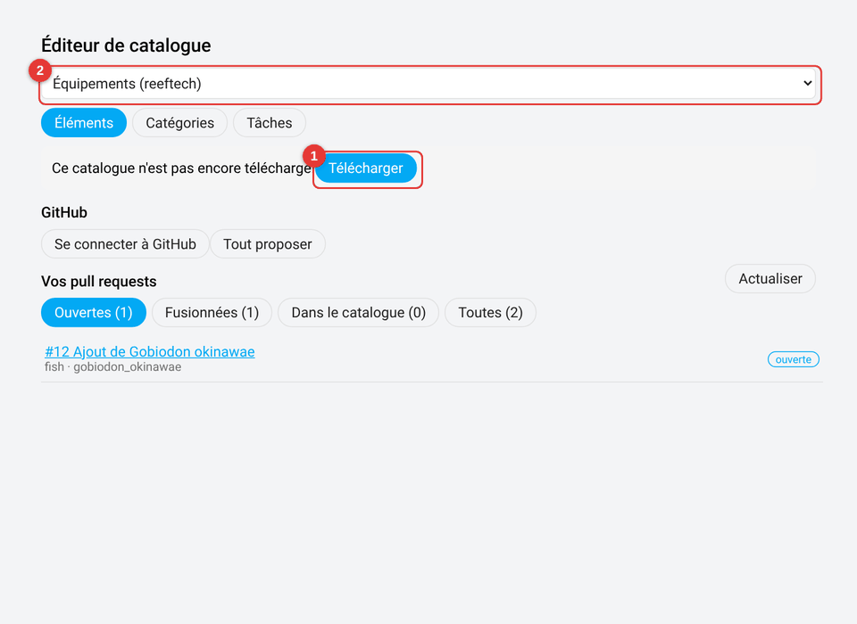

1. Cliquez sur **Télécharger** (1) : la carte récupère la dernière version publiée du catalogue.
2. Pour changer de catalogue, ouvrez la **liste déroulante** (2) en haut. Chaque nom est suivi de sa famille : *(reeftech)*, *(reeftank)* ou *(vue maison)*.

Le catalogue téléchargé est partagé avec les autres intégrations installées : un seul téléchargement pour tout le monde. Plus tard, le bouton **Rechercher une mise à jour** récupère une version plus récente.

> Si un catalogue n'apparaît pas dans la liste, c'est que vous n'y êtes pas abonné. Ajoutez-le dans *Configurer* sur la fiche de l'intégration.

## 4. Découvrir l'écran

Voici l'écran d'accueil. Les pastilles rouges correspondent à la liste ci-dessous.

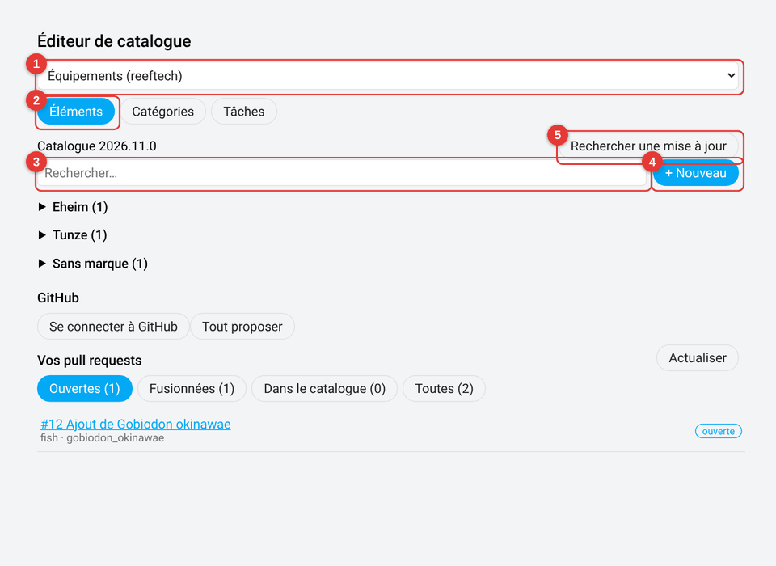

1. **Le catalogue** : la liste déroulante choisit celui que vous consultez.
2. **Le type de fiche** : un catalogue en contient plusieurs (ici Éléments, Catégories, Tâches).
3. **La recherche** : tapez quelques lettres, la liste se réduit aussitôt.
4. **+ Nouveau** : crée une fiche vide.
5. **Rechercher une mise à jour** : récupère une nouvelle version du catalogue.

Sous la liste, deux zones concernent GitHub : la **connexion** et vos **pull requests** (sections 8 et 9). Chaque ligne porte une étiquette : *catalogue* pour une fiche officielle, *à vous* pour une fiche que vous avez enregistrée chez vous.

## 5. Retrouver une fiche

- **Par la recherche** : tapez une partie du nom ou de l'identifiant. Si rien ne correspond, la carte affiche « Rien pour l'instant ».
- **Par la marque** : dans le catalogue d'équipements, les fiches sont rangées en groupes (Eheim, Tunze, Sans marque…). Cliquez sur la flèche d'un groupe pour le déplier.
- **Par le type d'eau** : dans les catalogues d'espèces ReefTank — **poissons, coraux, plantes et invertébrés** —, des boutons filtrent la liste : *Tous types d'eau*, *Eau de mer*, *Eau douce*, *Eau saumâtre*. Le chiffre entre parenthèses est le nombre de fiches concernées.

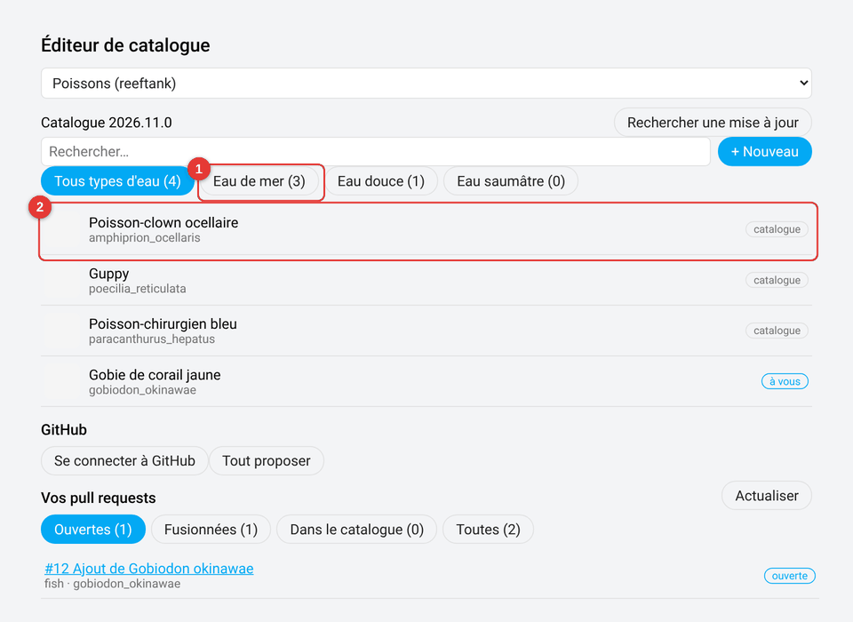

Les plantes et les invertébrés se trouvent exactement de la même façon :

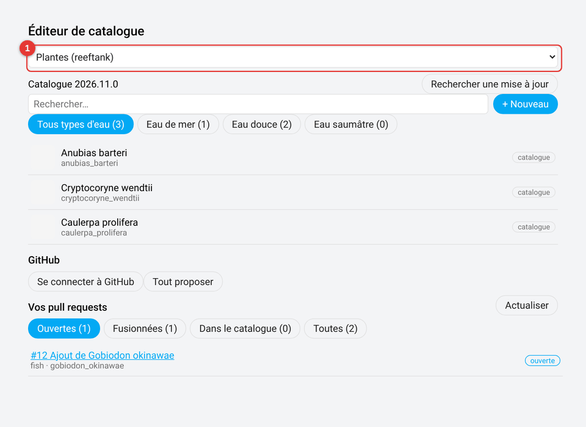

Pour ouvrir une fiche, cliquez simplement sur sa ligne.

## 6. Modifier ou créer une fiche

Le formulaire est généré automatiquement à partir des règles du catalogue : un champ ajouté au catalogue apparaît ici sans mise à jour de la carte.

- Les champs marqués d'une **étoile rouge** sont obligatoires.
- Pour une fiche **du catalogue**, un bandeau rappelle que l'enregistrer crée **votre propre version** : l'original n'est jamais modifié.
- **Identifiant** : proposé automatiquement (minuscules, chiffres, `-` et `_`). Pour une espèce, c'est son nom scientifique (`genre_espece`). Vous pouvez le corriger.
- **Noms en plusieurs langues** : renseignez au moins l'anglais. *Autres langues* déplie les autres ; le bouton **Traduire** remplit les langues manquantes à votre place.
- **Cases et listes** : types d'eau, compatibilité récif… selon la fiche. Une couleur (arbres, objets) se choisit avec le sélecteur ou se tape sous la forme `#rrggbb`.

Sous le formulaire, un message indique l'état de la fiche : **« Tout est en règle »** en vert, ou la liste de ce qu'il faut corriger. Tant qu'il reste une erreur, les boutons d'enregistrement sont grisés.

### Ce qui change selon le catalogue

| Catalogue | Image de la fiche |
| --- | --- |
| Équipements, suppléments, paramètres, tests d'eau, arbres, objets | Un bloc **Image** permet d'envoyer une image (convertie en WebP transparent) |
| **Poissons** | Pas d'image à envoyer : on fabrique une **animation** (section 7) |
| **Coraux, plantes, invertébrés** | L'éditeur modifie la **description** de l'espèce. Ses images sont construites avec les outils du catalogue ReefTank (voir son README) : ce formulaire n'a pas de bloc photo |

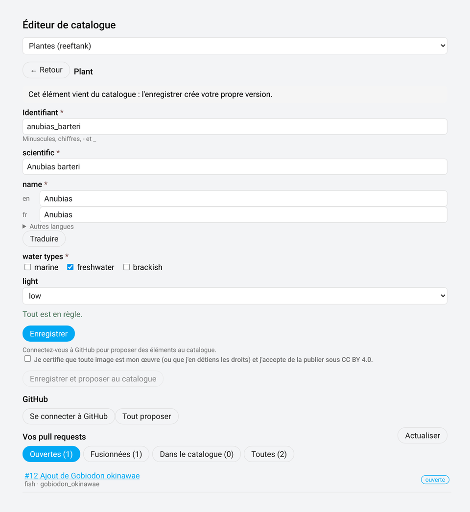

## 7. Poissons : photo et animation

Dans l'aquarium de ha-reef-card, un poisson peut être affiché à **trois niveaux de rendu**. C'est la clé pour comprendre ce que fait l'éditeur :

| Niveau | Ce que vous voyez | D'où ça vient |
| --- | --- | --- |
| **1. Poisson générique** | Un poisson « passe-partout », le même pour toutes les espèces concernées | Aucune image dans la fiche : c'est le rendu par défaut du catalogue (`unknown_fish`) |
| **2. Animation issue d'une photo** (« dégradée ») | Le vrai poisson, avec une animation simple : nage, repos, demi-tour | **Construite par l'éditeur** à partir d'une photo (générée par IA ou la vôtre) |
| **3. Animation issue de vidéos** (« réelle ») | Le vrai poisson, avec une animation fluide et naturelle | Construite **hors de l'éditeur**, avec les outils du catalogue ReefTank, à partir de courts clips vidéo (Kling, Veo…) |

L'éditeur sert donc à passer du niveau 1 au niveau 2, rapidement et sans vidéo. Le niveau 3 reste le but final : quand il existe, **il n'est jamais remplacé** par une animation issue d'une photo, sauf si vous cochez *« L'utiliser quand même (ignorer les contrôles) »*. À l'inverse, une animation de niveau 2 est conçue pour être remplacée un jour par une vraie.

Le bloc *Photo et animation* indique toujours où en est la fiche : *« Cette espèce n'a pas encore d'image »* (niveau 1), *« Son animation vient d'une photo… »* (niveau 2) ou *« Son animation vient de vidéos : une photo ne la remplace pas »* (niveau 3).

### Étape 1 — Préparer la photo

Le bloc *Photo et animation* se trouve sous le formulaire de l'espèce. Les pastilles rouges correspondent à :

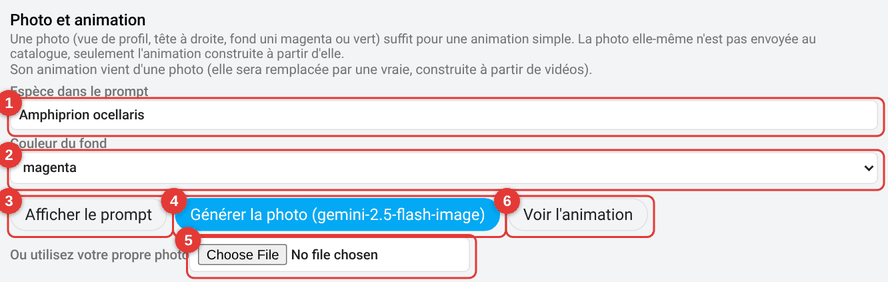

1. **Espèce dans le prompt** : le nom scientifique utilisé pour demander l'image (rempli pour vous).
2. **Couleur du fond** : magenta ou vert. Choisissez celle qui contraste le plus avec l'espèce (pas de magenta pour un poisson rose).
3. **Afficher le prompt** : montre le texte exact qui sera envoyé, pour le copier dans n'importe quel autre outil d'images.
4. **Générer la photo** : demande l'image à votre fournisseur d'IA. Il faut d'abord choisir le fournisseur (Google Gemini, OpenAI ou Cloudflare Workers AI) et saisir **votre clé d'API** dans les *Options* de l'intégration. La clé reste dans Home Assistant et n'est jamais renvoyée à la carte. Sans clé, ce bouton n'apparaît pas.
5. **Votre propre photo** : vous pouvez aussi envoyer un fichier (PNG, JPEG ou WebP). Indiquez alors son auteur et sa licence.
6. **Voir l'animation** : ouvre l'aperçu (étape 3). Ce bouton n'apparaît que si la fiche a déjà une animation ou que vous venez d'en construire une.

La photo doit montrer **un seul poisson, de profil, la tête à droite**, sur un fond uni.

### Étape 2 — Vérifier la photo et construire l'animation

Une fois la photo générée, elle s'affiche en miniature avec son origine (modèle utilisé, dimensions). L'éditeur la **contrôle** : fond uni, poisson entier et non coupé par le bord, taille suffisante. Si elle est refusée, la carte explique pourquoi : relancez la génération ou changez la couleur du fond.

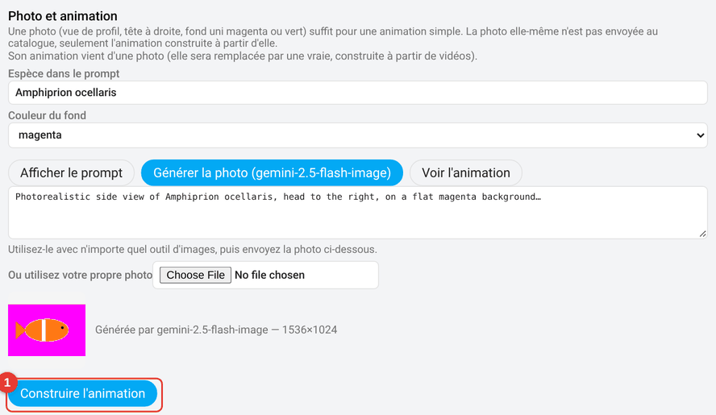

Si la photo est acceptée, cliquez sur **Construire l'animation**. Le message *« Animation prête : elle est jointe à l'enregistrement de la fiche »* confirme que tout est bon.

### Étape 3 — Visualiser l'animation

**Voir l'animation** ouvre un panneau à côté du formulaire. Il enchaîne en boucle quatre séquences : **immobile**, **nage**, **demi-tour**, puis le demi-tour **en miroir** pour que le poisson revienne dans le sens de départ. Le nom de la séquence en cours s'affiche au-dessus du poisson. *Fermer* ferme le panneau.

La liste **Fond** permet de juger le rendu sur trois arrière-plans : **Eau**, **Sombre** et **Clair**.

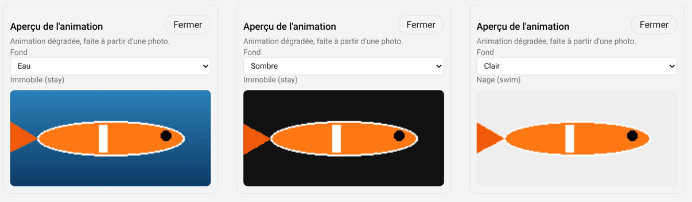

> Les captures de ce guide montrent un poisson dessiné pour l'exemple : l'animation réelle suit la photo de votre espèce.

## 8. Enregistrer et proposer au catalogue

### Enregistrer chez vous

**Enregistrer** range la fiche dans votre couche personnelle, partagée par toutes les intégrations : elle est utilisable **tout de suite**, sans attendre une publication. Pour une fiche du catalogue, c'est une copie locale (une *surcharge*) : elle garde l'image d'origine tant que vous n'en envoyez pas une nouvelle.

### Se connecter à GitHub (une fois)

1. Cliquez sur **Se connecter à GitHub** dans la zone GitHub.
2. La carte affiche un **code** (de la forme `ABCD-1234`) et une adresse GitHub.
3. Ouvrez l'adresse, saisissez le code et validez.
4. La carte détecte la connexion toute seule et affiche *« Connecté en tant que … »*.

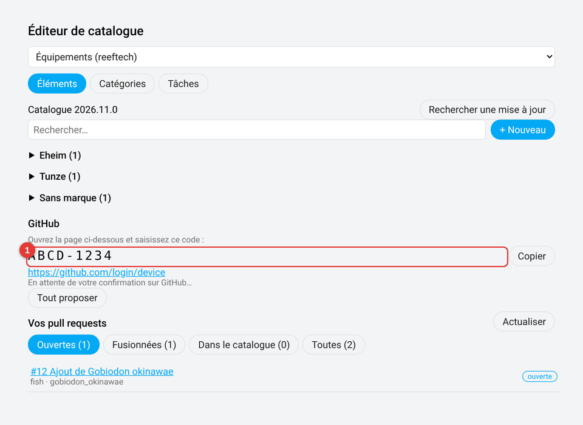

L'éditeur ne demande que l'autorisation `public_repo` : il crée une copie (*fork*) du catalogue, y pousse une branche et ouvre la demande d'ajout. Le jeton reste stocké dans Home Assistant. **Se déconnecter** l'efface.

### Proposer

1. Vérifiez que le message indique **« Tout est en règle »**.
2. Cochez la case de **certification** : vous attestez que toute image est votre œuvre (ou que vous en détenez les droits) et acceptez qu'elle soit publiée sous licence CC BY 4.0.
3. Cliquez sur **Enregistrer et proposer au catalogue**. Ce bouton reste grisé tant que vous n'êtes pas connecté, que la fiche a une erreur ou que la case n'est pas cochée.

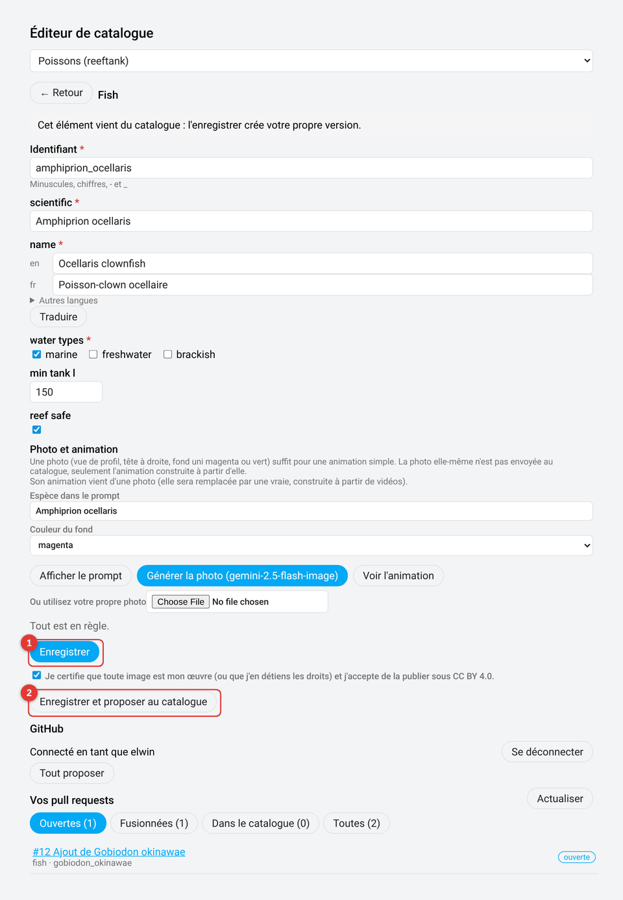

La carte affiche alors le numéro de la *pull request* ouverte. Si vous enregistrez de nouveau pendant qu'elle est ouverte, un nouveau commit s'y ajoute. Pour un poisson, la demande contient l'animation et sa vignette, **jamais la photo**.

**Tout proposer** envoie en une fois toutes vos fiches locales non encore proposées. Si elles concernent plusieurs catalogues, une pull request est ouverte par dépôt.

## 9. Suivre ses pull requests

En bas de la carte, **Vos pull requests** liste ce que vous avez proposé. Quatre boutons filtrent la liste (le chiffre indique combien de demandes sont concernées) :

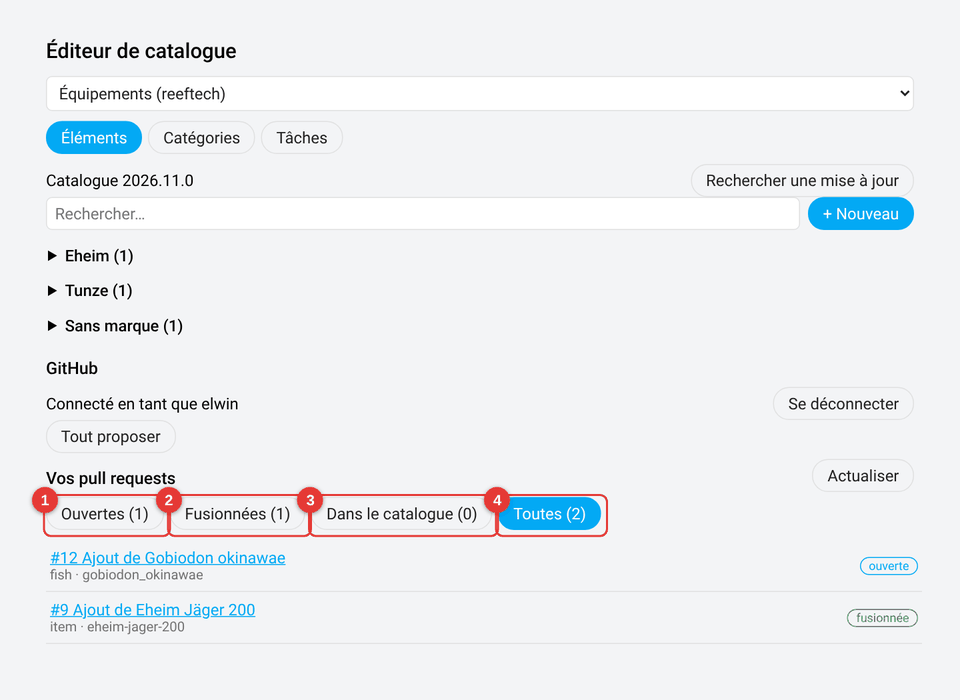

| Filtre | Ce qu'il montre |
| --- | --- |
| Ouvertes | Demandes en attente de relecture (affichage par défaut) |
| Fusionnées | Acceptées, mais pas encore dans une version publiée du catalogue |
| Dans le catalogue | Acceptées et publiées dans une version |
| Toutes | Tout, y compris les demandes refusées (repérées par une pastille) |

Cliquez sur le numéro d'une demande pour l'ouvrir sur GitHub. **Actualiser** recharge la liste.

Quand votre demande est fusionnée **et** publiée, votre copie locale est supprimée automatiquement si elle est identique à la fiche du catalogue. Sinon elle reste : supprimez-la à la main depuis la fiche.

## 10. Questions fréquentes

| Symptôme | Cause probable | Que faire |
| --- | --- | --- |
| Un catalogue manque dans la liste | Vous n'y êtes pas abonné | *Configurer* sur la fiche de l'intégration, cochez-le (elle se recharge) |
| Le bouton « Générer la photo » n'existe pas | Aucun fournisseur d'images configuré | Choisissez un fournisseur et saisissez votre clé dans les options de l'intégration ; ou envoyez votre propre photo |
| La photo est refusée | Fond pas uni, poisson coupé ou trop petit | Relancez la génération, ou changez la couleur du fond |
| Impossible de remplacer une animation | La fiche a déjà une animation issue de vidéos (niveau 3) | C'est voulu. Cochez *« L'utiliser quand même »* seulement si vous êtes sûr |
| « Enregistrer et proposer » est grisé | Pas connecté, erreur dans la fiche ou certification non cochée | Corrigez la fiche, connectez-vous, cochez la case |
| La connexion GitHub a expiré | Jeton révoqué ou expiré | Cliquez de nouveau sur *Se connecter à GitHub* ; la proposition en cours reprend après la connexion |
| La carte ne se met pas à jour | Cache du navigateur | Rechargez la page (Ctrl+F5) ; plusieurs rafraîchissements peuvent être nécessaires |

Une fiche que vous enregistrez est une **copie locale** : pour la retirer, ouvrez-la et utilisez le bouton de suppression.
