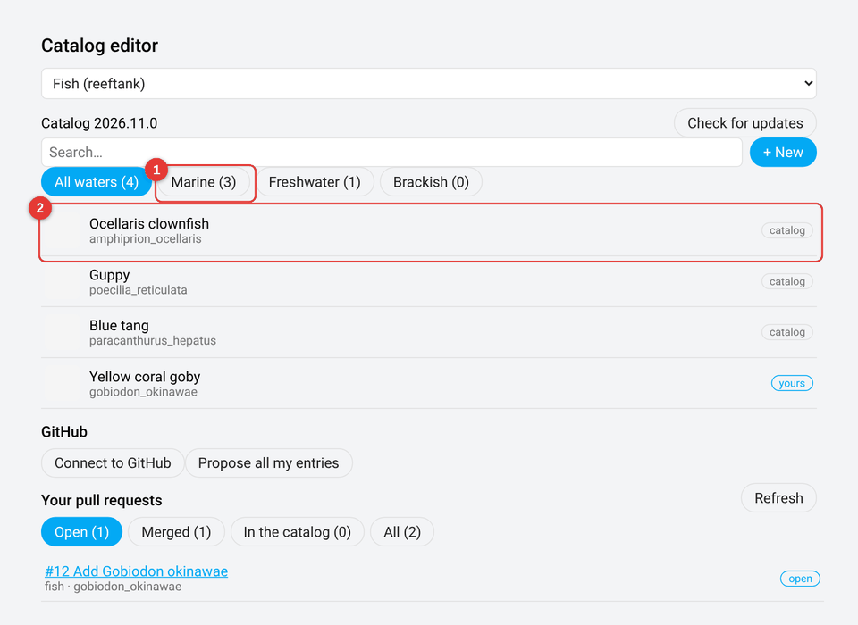
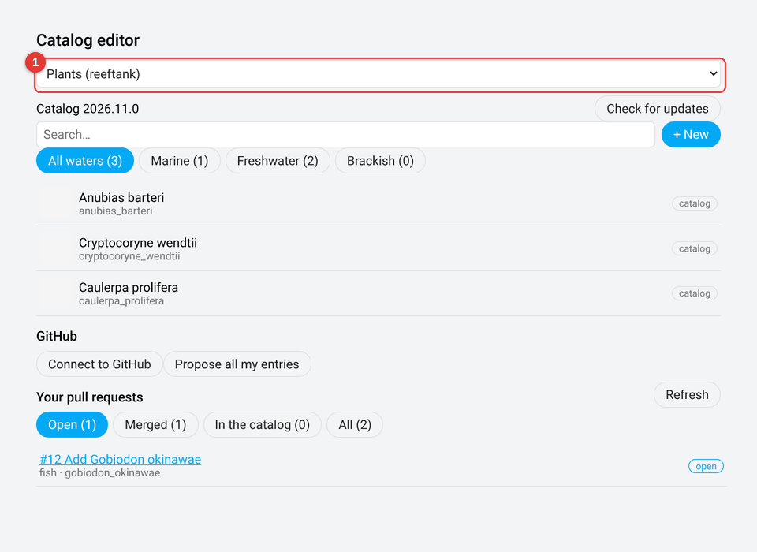

# Guida per l'utente — Editor del catalogo

[English](guide.en.md) · [Français](guide.fr.md) · [Deutsch](guide.de.md) · [Español](guide.es.md) · **Italiano** · [Nederlands](guide.nl.md) · [Polski](guide.pl.md) · [Português](guide.pt.md)

L'editor del catalogo è una scheda di Home Assistant che permette di **consultare, modificare e creare** le voci dei cataloghi ReefTech (attrezzature, integratori…), della vista della casa (alberi, oggetti) e di ReefTank (pesci, coralli, piante, invertebrati), e poi di **proporle** alla comunità.

## 1. A cosa serve l'editor?

Immagini uno schedario: una scheda per ogni riscaldatore, integratore, pesce o albero. L'editor è la scheda che permette di leggerle, correggerne una o aggiungerne una nuova, direttamente dalla dashboard, senza toccare alcun file.

Tre idee da ricordare:

1. **Ciò che salva è subito utilizzabile** a casa sua: la voce finisce nel suo «livello utente», condiviso da tutte le integrazioni che leggono il catalogo.
2. **Proporla al catalogo è un passaggio in più, facoltativo**: l'editor apre per lei una *pull request* (una richiesta di inserimento) su GitHub, perché la sua voce sia utile a tutti.
3. **L'editor controlla le sue voci** con le stesse regole del catalogo: se dice «Everything checks out», la voce sarà accettata.

## 2. Prima di iniziare

### Installare e aggiungere la scheda

1. Installi l'integrazione *Catalog editor* (repository personalizzato HACS, oppure copiando la cartella `custom_components/catalog_editor`) e la aggiunga in *Impostazioni → Dispositivi e servizi*.
2. L'integrazione chiede il **client ID di un'app OAuth di GitHub** (vedi sotto) e i **cataloghi a cui iscriversi** (attrezzature, integratori, parametri, test dell'acqua, alberi, oggetti e le specie ReefTank: pesci, coralli, piante, invertebrati). Tutto è selezionato per impostazione predefinita; potrà cambiarlo in seguito in *Configura*.
3. In una dashboard, aggiunga una scheda manuale con questo codice:

```yaml
type: custom:catalog-editor-card
```

La scheda è fornita dall'integrazione: non c'è nulla da aggiungere alle risorse. Viene mostrata in francese o in inglese a seconda della lingua di Home Assistant.

### Creare l'app GitHub (una volta sola, 1 minuto)

Questo passaggio serve solo se vuole **proporre** voci al catalogo. Per modificare a casa sua può saltarlo.

1. Apra <https://github.com/settings/applications/new> (con l'accesso a GitHub effettuato).
2. *Application name*: quello che vuole, ad esempio `Catalog editor`. *Homepage URL* e *Authorization callback URL*: un indirizzo qualsiasi, ad esempio `https://github.com/Elwinmage/catalog-editor` (non vengono usati).
3. Spunti **Enable Device Flow**, poi **Register application**.
4. Copi il **Client ID** della pagina successiva nell'integrazione. Non serve alcun segreto.

## 3. Primo avvio: scaricare un catalogo

La prima volta, il catalogo non è ancora sul suo Home Assistant. La scheda lo dice: *«This catalog is not downloaded yet»*.


1. Faccia clic su **Download** (1): la scheda recupera l'ultima versione pubblicata del catalogo.
2. Per cambiare catalogo, apra l'**elenco a discesa** (2) in alto. Ogni nome è seguito dalla sua famiglia: *(reeftech)*, *(reeftank)* o *(house view)*.

Il catalogo scaricato è condiviso con le altre integrazioni installate: un solo download per tutti. In seguito, **Check for updates** recupera una versione più recente.

> Se un catalogo manca nell'elenco, non vi è iscritto. Lo aggiunga in *Configura*, nell'integrazione.

## 4. Giro dello schermo

Questa è la schermata iniziale. I segnaposto rossi corrispondono all'elenco qui sotto.


1. **Il catalogo**: l'elenco a discesa sceglie quello che consulta.
2. **Il tipo di voce**: un catalogo ne contiene diversi (qui Items, Categories, Tasks).
3. **La ricerca**: digiti qualche lettera, l'elenco si restringe subito.
4. **+ New**: crea una voce vuota.
5. **Check for updates**: recupera una nuova versione del catalogo.

Sotto l'elenco, due aree riguardano GitHub: la **connessione** e le sue **pull request** (sezioni 8 e 9). Ogni riga ha un'etichetta: *catalog* per una voce ufficiale, *yours* per una voce salvata a casa sua.

## 5. Ritrovare una voce

- **Con la ricerca**: digiti parte del nome o dell'identificatore. Se nulla corrisponde, la scheda mostra «Nothing here yet».
- **Per marca**: nel catalogo delle attrezzature le voci sono raggruppate (Eheim, Tunze, senza marca…). Faccia clic sulla freccia di un gruppo per aprirlo.
- **Per tipo d'acqua**: nei cataloghi di specie ReefTank — **pesci, coralli, piante e invertebrati** — dei pulsanti filtrano l'elenco: *All waters*, *Marine*, *Freshwater*, *Brackish*. Il numero tra parentesi è il numero di voci.



Piante e invertebrati si trovano esattamente allo stesso modo:



Per aprire una voce, faccia semplicemente clic sulla sua riga.

## 6. Modificare o creare una voce

Il modulo viene generato dalle regole del catalogo: un campo aggiunto al catalogo compare qui senza aggiornare la scheda.

- I campi con una **stella rossa** sono obbligatori.
- Per una voce **del catalogo**, un avviso ricorda che salvarla crea **la sua versione personale**: l'originale non viene mai modificato.
- **Identificatore**: proposto automaticamente (minuscole, cifre, `-` e `_`). Per una specie è il nome scientifico (`genere_specie`). Può correggerlo.
- **Nomi in più lingue**: compili almeno l'inglese. *Other languages* apre le altre; il pulsante **Translate** compila quelle mancanti al suo posto.
- **Caselle ed elenchi**: tipi d'acqua, compatibilità con la barriera… a seconda della voce. Un colore (alberi, oggetti) si sceglie con il selettore o si digita come `#rrggbb`.

Sotto il modulo, un messaggio indica lo stato della voce: **«Everything checks out»** in verde, oppure l'elenco di ciò che va corretto. Finché resta un errore, i pulsanti di salvataggio sono disattivati.

### Cosa cambia a seconda del catalogo

| Catalogo | Immagine della voce |
| --- | --- |
| Attrezzature, integratori, parametri, test dell'acqua, alberi, oggetti | Un blocco **Image** permette di caricare un'immagine (convertita in WebP trasparente) |
| **Pesci** | Nessuna immagine da caricare: si costruisce un'**animazione** (sezione 7) |
| **Coralli, piante, invertebrati** | L'editor modifica la **descrizione** della specie. Le sue immagini si costruiscono con gli strumenti del catalogo ReefTank (vedi il suo README): questo modulo non ha il blocco foto |


## 7. Pesci: foto e animazione

Nell'acquario di ha-reef-card, un pesce può essere mostrato a **tre livelli di resa**. È la chiave per capire cosa fa l'editor:

| Livello | Cosa si vede | Da dove viene |
| --- | --- | --- |
| **1. Pesce generico** | Un pesce jolly, lo stesso per tutte le specie interessate | Nessuna immagine nella voce: è il valore predefinito del catalogo (`unknown_fish`) |
| **2. Animazione da una foto** («degraded») | Il pesce vero, con un'animazione semplice: nuoto, riposo, inversione | **Costruita dall'editor** a partire da una foto (generata dall'IA o sua) |
| **3. Animazione da video** («real») | Il pesce vero, con un'animazione fluida e naturale | Costruita **fuori dall'editor**, con gli strumenti del catalogo ReefTank, da brevi clip video (Kling, Veo…) |

L'editor serve quindi a passare dal livello 1 al livello 2, in fretta e senza video. Il livello 3 resta l'obiettivo finale: quando esiste, **non viene mai sostituito** da un'animazione ottenuta da una foto, a meno che lei non spunti *«Use it anyway (ignore the checks)»*. Al contrario, un'animazione di livello 2 è pensata per essere un giorno sostituita da una vera.

Il blocco *Photo and animation* indica sempre a che punto è la voce: *«This species has no picture yet»* (livello 1), *«Its animation was made from a photo…»* (livello 2) o *«Its animation was made from videos: a photo does not replace it»* (livello 3).

### Passo 1 — Preparare la foto

Il blocco *Photo and animation* si trova sotto il modulo della specie. I segnaposto rossi corrispondono a:


1. **Species in the prompt**: il nome scientifico usato per richiedere l'immagine (già compilato).
2. **Background colour**: magenta o verde. Scelga quello che contrasta di più con la specie (niente magenta per un pesce rosa).
3. **Show the prompt**: mostra il testo esatto che verrà inviato, per copiarlo in qualsiasi altro strumento di immagini.
4. **Generate the photo**: chiede l'immagine al suo fornitore di IA. Prima scelga il fornitore (Google Gemini, OpenAI o Cloudflare Workers AI) e inserisca **la sua chiave API** nelle *Opzioni* dell'integrazione. La chiave resta in Home Assistant e non viene mai rinviata alla scheda. Senza chiave questo pulsante non compare.
5. **La sua foto**: può anche caricare un file (PNG, JPEG o WebP). Indichi allora autore e licenza.
6. **Play the animation**: apre l'anteprima (passo 3). Il pulsante compare solo se la voce ha già un'animazione o se ne ha appena costruita una.

La foto deve mostrare **un solo pesce, di profilo, con la testa a destra**, su sfondo uniforme.

### Passo 2 — Controllare la foto e costruire l'animazione

Una volta generata, la foto appare in miniatura con la sua origine (modello usato, dimensioni). L'editor la **controlla**: sfondo uniforme, pesce intero non tagliato dal bordo, dimensioni sufficienti. Se viene rifiutata, la scheda spiega perché: rigeneri o cambi il colore dello sfondo.


Se la foto è accettata, faccia clic su **Build the animation**. Il messaggio *«Animation ready: it is attached when you save the entry»* conferma che tutto va bene.

### Passo 3 — Guardare l'animazione

**Play the animation** apre un pannello accanto al modulo. Concatena in ciclo quattro sequenze: **stay** (fermo), **swim** (nuoto), **turn** (inversione), poi l'inversione **speculare** perché il pesce torni a guardare nella direzione di partenza. Il nome della sequenza in corso appare sopra il pesce. *Close* chiude il pannello.

L'elenco **Background** permette di giudicare il risultato su tre sfondi: **Water**, **Dark** e **Light**.


> Gli screenshot di questa guida mostrano un pesce disegnato per l'esempio: l'animazione reale segue la foto della sua specie.

## 8. Salvare e proporre al catalogo

### Salvare a casa sua

**Save** mette la voce nel suo livello utente, condiviso da tutte le integrazioni: è utilizzabile **subito**, senza attendere una pubblicazione. Per una voce del catalogo è una copia locale (un *override*): conserva l'immagine originale finché non ne carica una nuova.

### Connettersi a GitHub (una volta)

1. Faccia clic su **Connect to GitHub** nell'area GitHub.
2. La scheda mostra un **codice** (del tipo `ABCD-1234`) e un indirizzo GitHub.
3. Apra l'indirizzo, digiti il codice e confermi.
4. La scheda rileva da sola la connessione e mostra *«Connected as …»*.


L'editor chiede solo il permesso `public_repo`: fa il fork del catalogo, invia un branch e apre la pull request. Il token resta memorizzato in Home Assistant. **Disconnect** lo cancella.

### Proporre

1. Verifichi che il messaggio dica **«Everything checks out»**.
2. Spunti la casella di **certificazione**: dichiara che ogni immagine è opera sua (o che ne detiene i diritti) e accetta che venga pubblicata con licenza CC BY 4.0.
3. Faccia clic su **Save and propose to the catalog**. Il pulsante resta disattivato finché non è connesso, la voce ha un errore o la casella non è spuntata.


La scheda mostra allora il numero della pull request aperta. Se salva di nuovo mentre è aperta, viene aggiunto un nuovo commit. Per un pesce, la richiesta contiene l'animazione e la sua miniatura, **mai la foto**.

**Propose all my entries** invia in una volta tutte le sue voci locali non ancora proposte. Se appartengono a più cataloghi, viene aperta una pull request per repository.

## 9. Seguire le sue pull request

In fondo alla scheda, **Your pull requests** elenca ciò che ha proposto. Quattro pulsanti filtrano l'elenco (il numero indica quante richieste ci sono):


| Filtro | Cosa mostra |
| --- | --- |
| Open | Richieste in attesa di revisione (vista predefinita) |
| Merged | Accettate, ma non ancora in una versione pubblicata del catalogo |
| In the catalog | Accettate e pubblicate in una versione |
| All | Tutto, comprese le richieste rifiutate (segnalate da un badge) |

Faccia clic sul numero di una richiesta per aprirla su GitHub. **Refresh** ricarica l'elenco.

Quando la richiesta è unita **e** pubblicata, la sua copia locale viene rimossa automaticamente se è identica alla voce del catalogo. Altrimenti resta: la elimini a mano dalla voce.

## 10. Domande frequenti

| Sintomo | Causa probabile | Cosa fare |
| --- | --- | --- |
| Un catalogo manca nell'elenco | Non è iscritto | *Configura* nell'integrazione, lo selezioni (si ricarica) |
| Non c'è il pulsante «Generate the photo» | Nessun fornitore di immagini configurato | Scelga un fornitore e inserisca la chiave nelle opzioni; oppure carichi la sua foto |
| La foto viene rifiutata | Sfondo non uniforme, pesce tagliato o troppo piccolo | Rigeneri o cambi il colore dello sfondo |
| Non si può sostituire un'animazione | La voce ha già un'animazione ottenuta da video (livello 3) | È voluto. Spunti *«Use it anyway»* solo se è sicuro |
| «Save and propose» è disattivato | Non connesso, errore nella voce o certificazione non spuntata | Corregga la voce, si connetta, spunti la casella |
| La connessione a GitHub è scaduta | Token revocato o scaduto | Faccia di nuovo clic su *Connect to GitHub*; la proposta in corso riprende dopo la connessione |
| La scheda non si aggiorna | Cache del browser | Ricarichi la pagina (Ctrl+F5); possono servire più aggiornamenti |

Una voce che salva è una **copia locale**: per rimuoverla, la apra e usi il pulsante di eliminazione.
