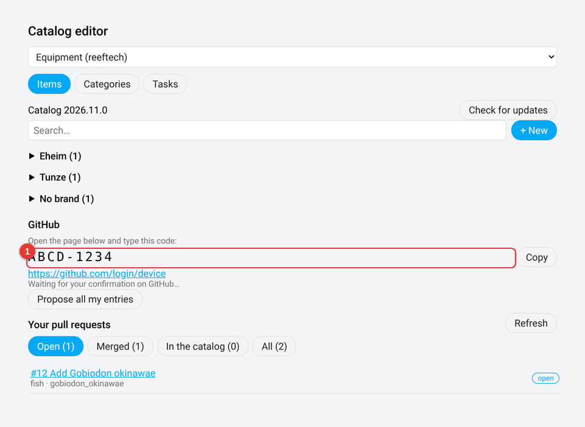

# Podręcznik użytkownika — Edytor katalogu

[English](guide.en.md) · [Français](guide.fr.md) · [Deutsch](guide.de.md) · [Español](guide.es.md) · [Italiano](guide.it.md) · [Nederlands](guide.nl.md) · **Polski** · [Português](guide.pt.md)

Edytor katalogu to karta Home Assistant, która pozwala **przeglądać, edytować i tworzyć** wpisy katalogów ReefTech (wyposażenie, suplementy…), widoku domu (drzewa, obiekty) oraz ReefTank (ryby, koralowce, rośliny, bezkręgowce), a następnie **zgłaszać je** społeczności.

## 1. Do czego służy edytor?

Wyobraź sobie kartotekę: jedna karta na grzałkę, suplement, rybę czy drzewo. Edytor to karta, dzięki której możesz je czytać, poprawić jedną lub dodać nową, wprost z pulpitu, bez dotykania żadnego pliku.

Trzy rzeczy do zapamiętania:

1. **To, co zapiszesz, działa od razu** u Ciebie: wpis trafia do Twojej „warstwy użytkownika”, współdzielonej przez wszystkie integracje czytające katalog.
2. **Zgłoszenie do katalogu to dodatkowy, opcjonalny krok**: edytor otwiera za Ciebie *pull request* (prośbę o dodanie) na GitHubie, aby Twój wpis przydał się wszystkim.
3. **Edytor sprawdza Twoje wpisy** tymi samymi regułami co katalog: jeśli pokaże „Everything checks out”, wpis zostanie zaakceptowany.

## 2. Zanim zaczniesz

### Instalacja i dodanie karty

1. Zainstaluj integrację *Catalog editor* (własne repozytorium HACS lub skopiowanie folderu `custom_components/catalog_editor`) i dodaj ją w *Ustawienia → Urządzenia i usługi*.
2. Integracja prosi o **identyfikator klienta aplikacji OAuth GitHub** (patrz niżej) oraz o **katalogi do subskrypcji** (wyposażenie, suplementy, parametry, testy wody, drzewa, obiekty i gatunki ReefTank: ryby, koralowce, rośliny, bezkręgowce). Domyślnie wszystko jest zaznaczone; można to później zmienić w *Konfiguruj*.
3. Na pulpicie dodaj kartę ręczną z tym kodem:

```yaml
type: custom:catalog-editor-card
```

Kartę udostępnia integracja: nie trzeba nic dodawać do zasobów. Wyświetla się po francusku lub angielsku, zależnie od języka Home Assistant.

### Utworzenie aplikacji GitHub (jednorazowo, 1 minuta)

Ten krok jest potrzebny tylko wtedy, gdy chcesz **zgłaszać** wpisy do katalogu. Do edycji u siebie możesz go pominąć.

1. Otwórz <https://github.com/settings/applications/new> (zalogowany na GitHubie).
2. *Application name*: dowolna, np. `Catalog editor`. *Homepage URL* i *Authorization callback URL*: dowolny adres, np. `https://github.com/Elwinmage/catalog-editor` (nie są używane).
3. Zaznacz **Enable Device Flow**, potem **Register application**.
4. Skopiuj **Client ID** z następnej strony do integracji. Sekret nie jest potrzebny.

## 3. Pierwsze uruchomienie: pobranie katalogu

Za pierwszym razem katalogu nie ma jeszcze w Twoim Home Assistant. Karta to mówi: *„This catalog is not downloaded yet”*.


1. Kliknij **Download** (1): karta pobierze ostatnią opublikowaną wersję katalogu.
2. Aby zmienić katalog, otwórz **listę rozwijaną** (2) u góry. Za każdą nazwą stoi jej rodzina: *(reeftech)*, *(reeftank)* lub *(house view)*.

Pobrany katalog jest współdzielony z innymi zainstalowanymi integracjami: jedno pobranie dla wszystkich. Później **Check for updates** pobiera nowszą wersję.

> Jeśli katalogu brakuje na liście, nie jesteś go subskrybentem. Dodaj go w *Konfiguruj* przy integracji.

## 4. Przegląd ekranu

To ekran główny. Czerwone znaczniki odpowiadają liście poniżej.


1. **Katalog**: lista rozwijana wybiera ten, który przeglądasz.
2. **Rodzaj wpisu**: katalog zawiera ich kilka (tu Items, Categories, Tasks).
3. **Wyszukiwanie**: wpisz kilka liter, lista od razu się zawęża.
4. **+ New**: tworzy pusty wpis.
5. **Check for updates**: pobiera nową wersję katalogu.

Pod listą dwa obszary dotyczą GitHuba: **połączenie** i Twoje **pull requesty** (rozdziały 8 i 9). Każdy wiersz ma etykietę: *catalog* dla wpisu oficjalnego, *yours* dla wpisu zapisanego u Ciebie.

## 5. Odnalezienie wpisu

- **Wyszukiwarką**: wpisz fragment nazwy lub identyfikatora. Jeśli nic nie pasuje, karta pokaże „Nothing here yet”.
- **Według marki**: w katalogu wyposażenia wpisy są pogrupowane (Eheim, Tunze, bez marki…). Kliknij strzałkę grupy, aby ją rozwinąć.
- **Według rodzaju wody**: w katalogach gatunków ReefTank — **ryby, koralowce, rośliny i bezkręgowce** — przyciski filtrują listę: *All waters*, *Marine*, *Freshwater*, *Brackish*. Liczba w nawiasie to liczba wpisów.


Rośliny i bezkręgowce znajdziesz dokładnie tak samo:


Aby otworzyć wpis, po prostu kliknij jego wiersz.

## 6. Edycja lub tworzenie wpisu

Formularz jest generowany z reguł katalogu: pole dodane do katalogu pojawia się tu bez aktualizacji karty.

- Pola oznaczone **czerwoną gwiazdką** są wymagane.
- Przy wpisie **z katalogu** baner przypomina, że zapis tworzy **Twoją własną wersję**: oryginał nigdy nie jest zmieniany.
- **Identyfikator**: podpowiadany automatycznie (małe litery, cyfry, `-` i `_`). Dla gatunku jest to nazwa naukowa (`rodzaj_gatunek`). Możesz go poprawić.
- **Nazwy w kilku językach**: wypełnij co najmniej angielski. *Other languages* rozwija pozostałe; przycisk **Translate** uzupełnia brakujące za Ciebie.
- **Pola wyboru i listy**: rodzaje wody, bezpieczne dla rafy… zależnie od wpisu. Kolor (drzewa, obiekty) wybierasz selektorem lub wpisujesz jako `#rrggbb`.

Pod formularzem komunikat pokazuje stan wpisu: **„Everything checks out”** na zielono albo listę rzeczy do poprawienia. Dopóki jest błąd, przyciski zapisu są wyszarzone.

### Co zmienia się w zależności od katalogu

| Katalog | Obraz wpisu |
| --- | --- |
| Wyposażenie, suplementy, parametry, testy wody, drzewa, obiekty | Blok **Image** pozwala wgrać obraz (konwertowany do przezroczystego WebP) |
| **Ryby** | Brak obrazu do wgrania: budujesz **animację** (rozdział 7) |
| **Koralowce, rośliny, bezkręgowce** | Edytor zmienia **opis** gatunku. Jego obrazy powstają za pomocą narzędzi katalogu ReefTank (zob. jego README): ten formularz nie ma bloku zdjęcia |


## 7. Ryby: zdjęcie i animacja

W akwarium ha-reef-card ryba może być pokazana na **trzech poziomach renderowania**. To klucz do zrozumienia, co robi edytor:

| Poziom | Co widać | Skąd się bierze |
| --- | --- | --- |
| **1. Ryba ogólna** | Uniwersalna ryba, ta sama dla wszystkich objętych gatunków | Brak obrazu we wpisie: to wartość domyślna katalogu (`unknown_fish`) |
| **2. Animacja ze zdjęcia** („degraded”) | Prawdziwa ryba z prostą animacją: pływanie, spoczynek, zawracanie | **Zbudowana przez edytor** ze zdjęcia (wygenerowanego przez AI lub Twojego) |
| **3. Animacja z wideo** („real”) | Prawdziwa ryba z płynną, naturalną animacją | Zbudowana **poza edytorem**, narzędziami katalogu ReefTank, z krótkich klipów wideo (Kling, Veo…) |

Edytor służy więc do przejścia z poziomu 1 na poziom 2, szybko i bez wideo. Poziom 3 pozostaje celem ostatecznym: gdy istnieje, **nigdy nie jest zastępowany** animacją ze zdjęcia, chyba że zaznaczysz *„Use it anyway (ignore the checks)”*. I odwrotnie: animacja poziomu 2 ma być kiedyś zastąpiona prawdziwą.

Blok *Photo and animation* zawsze mówi, na jakim etapie jest wpis: *„This species has no picture yet”* (poziom 1), *„Its animation was made from a photo…”* (poziom 2) lub *„Its animation was made from videos: a photo does not replace it”* (poziom 3).

### Krok 1 — Przygotowanie zdjęcia

Blok *Photo and animation* znajduje się pod formularzem gatunku. Czerwone znaczniki odpowiadają:


1. **Species in the prompt**: nazwa naukowa użyta do zamówienia obrazu (wypełniona za Ciebie).
2. **Background colour**: magenta lub zielony. Wybierz ten, który najmocniej kontrastuje z gatunkiem (żadnej magenty dla różowej ryby).
3. **Show the prompt**: pokazuje dokładny tekst, który zostanie wysłany, abyś mógł go użyć w innym narzędziu do obrazów.
4. **Generate the photo**: zamawia obraz u Twojego dostawcy AI. Najpierw wybierz dostawcę (Google Gemini, OpenAI lub Cloudflare Workers AI) i wpisz **własny klucz API** w *Opcjach* integracji. Klucz zostaje w Home Assistant i nigdy nie wraca do karty. Bez klucza ten przycisk się nie pojawia.
5. **Własne zdjęcie**: możesz też wgrać plik (PNG, JPEG lub WebP). Podaj wtedy autora i licencję.
6. **Play the animation**: otwiera podgląd (krok 3). Przycisk pojawia się tylko wtedy, gdy wpis ma już animację lub właśnie ją zbudowałeś.

Zdjęcie musi przedstawiać **jedną rybę z profilu, głową w prawo**, na jednolitym tle.

### Krok 2 — Sprawdzenie zdjęcia i zbudowanie animacji

Po wygenerowaniu zdjęcie pojawia się jako miniatura z informacją o pochodzeniu (użyty model, wymiary). Edytor je **sprawdza**: jednolite tło, cała ryba nieucięta przez krawędź, wystarczający rozmiar. Jeśli zostanie odrzucone, karta wyjaśni dlaczego: wygeneruj ponownie lub zmień kolor tła.


Jeśli zdjęcie zostanie przyjęte, kliknij **Build the animation**. Komunikat *„Animation ready: it is attached when you save the entry”* potwierdza, że wszystko jest w porządku.

### Krok 3 — Obejrzenie animacji

**Play the animation** otwiera panel obok formularza. Zapętla cztery sekwencje: **stay** (bezruch), **swim** (pływanie), **turn** (zawracanie), a potem zawracanie **w odbiciu lustrzanym**, aby ryba znów patrzyła w kierunku początkowym. Nazwa bieżącej sekwencji widnieje nad rybą. *Close* zamyka panel.

Lista **Background** pozwala ocenić efekt na trzech tłach: **Water**, **Dark** i **Light**.


> Zrzuty ekranu w tym podręczniku pokazują rybę narysowaną na potrzeby przykładu: prawdziwa animacja podąża za zdjęciem Twojego gatunku.

## 8. Zapis i zgłoszenie do katalogu

### Zapis u siebie

**Save** umieszcza wpis w Twojej warstwie użytkownika, współdzielonej przez wszystkie integracje: działa **od razu**, bez czekania na wydanie. Dla wpisu z katalogu jest to lokalna kopia (*nadpisanie*): zachowuje oryginalny obraz, dopóki nie wgrasz nowego.

### Połączenie z GitHubem (jednorazowo)

1. Kliknij **Connect to GitHub** w obszarze GitHub.
2. Karta pokazuje **kod** (np. `ABCD-1234`) i adres GitHub.
3. Otwórz adres, wpisz kod i potwierdź.
4. Karta sama wykryje połączenie i pokaże *„Connected as …”*.



Edytor prosi tylko o uprawnienie `public_repo`: tworzy fork katalogu, wypycha gałąź i otwiera pull request. Token pozostaje zapisany w Home Assistant. **Disconnect** go usuwa.

### Zgłoszenie

1. Sprawdź, czy komunikat brzmi **„Everything checks out”**.
2. Zaznacz pole **certyfikacji**: oświadczasz, że każdy obraz jest Twoim dziełem (lub że posiadasz prawa) i zgadzasz się na publikację na licencji CC BY 4.0.
3. Kliknij **Save and propose to the catalog**. Przycisk pozostaje wyszarzony, dopóki nie jesteś połączony, wpis ma błąd lub pole nie jest zaznaczone.


Karta pokazuje wtedy numer otwartego pull requesta. Jeśli zapiszesz ponownie, gdy jest otwarty, dodawany jest kolejny commit. Dla ryby prośba zawiera animację i jej miniaturę, **nigdy zdjęcia**.

**Propose all my entries** wysyła naraz wszystkie Twoje lokalne wpisy, które nie zostały jeszcze zgłoszone. Jeśli należą do kilku katalogów, otwierany jest jeden pull request na repozytorium.

## 9. Śledzenie pull requestów

Na dole karty **Your pull requests** wymienia to, co zgłosiłeś. Cztery przyciski filtrują listę (liczba mówi, ile jest próśb):


| Filtr | Co pokazuje |
| --- | --- |
| Open | Prośby czekające na przegląd (widok domyślny) |
| Merged | Zaakceptowane, ale jeszcze nie w opublikowanej wersji katalogu |
| In the catalog | Zaakceptowane i opublikowane w wersji |
| All | Wszystko, także odrzucone prośby (oznaczone plakietką) |

Kliknij numer prośby, aby otworzyć ją na GitHubie. **Refresh** przeładowuje listę.

Gdy Twoja prośba zostanie scalona **i** wydana, Twoja lokalna kopia jest usuwana automatycznie, jeśli jest identyczna z wpisem katalogu. W przeciwnym razie zostaje: usuń ją ręcznie z poziomu wpisu.

## 10. Najczęstsze pytania

| Objaw | Prawdopodobna przyczyna | Co zrobić |
| --- | --- | --- |
| Katalogu brakuje na liście | Brak subskrypcji | *Konfiguruj* przy integracji, zaznacz go (integracja się przeładuje) |
| Nie ma przycisku „Generate the photo” | Nie skonfigurowano dostawcy obrazów | Wybierz dostawcę i wpisz klucz w opcjach; albo wgraj własne zdjęcie |
| Zdjęcie jest odrzucone | Tło niejednolite, ryba ucięta lub zbyt mała | Wygeneruj ponownie lub zmień kolor tła |
| Nie można zastąpić animacji | Wpis ma już animację z wideo (poziom 3) | To zamierzone. Zaznacz *„Use it anyway”* tylko wtedy, gdy masz pewność |
| „Save and propose” jest wyszarzone | Brak połączenia, błąd we wpisie lub niezaznaczona certyfikacja | Popraw wpis, połącz się, zaznacz pole |
| Logowanie GitHub wygasło | Token cofnięty lub wygasły | Kliknij ponownie *Connect to GitHub*; zgłoszenie w toku wznawia się po zalogowaniu |
| Karta się nie aktualizuje | Pamięć podręczna przeglądarki | Odśwież stronę (Ctrl+F5); może być potrzebnych kilka odświeżeń |

Zapisany wpis jest **lokalną kopią**: aby go usunąć, otwórz go i użyj przycisku usuwania.
