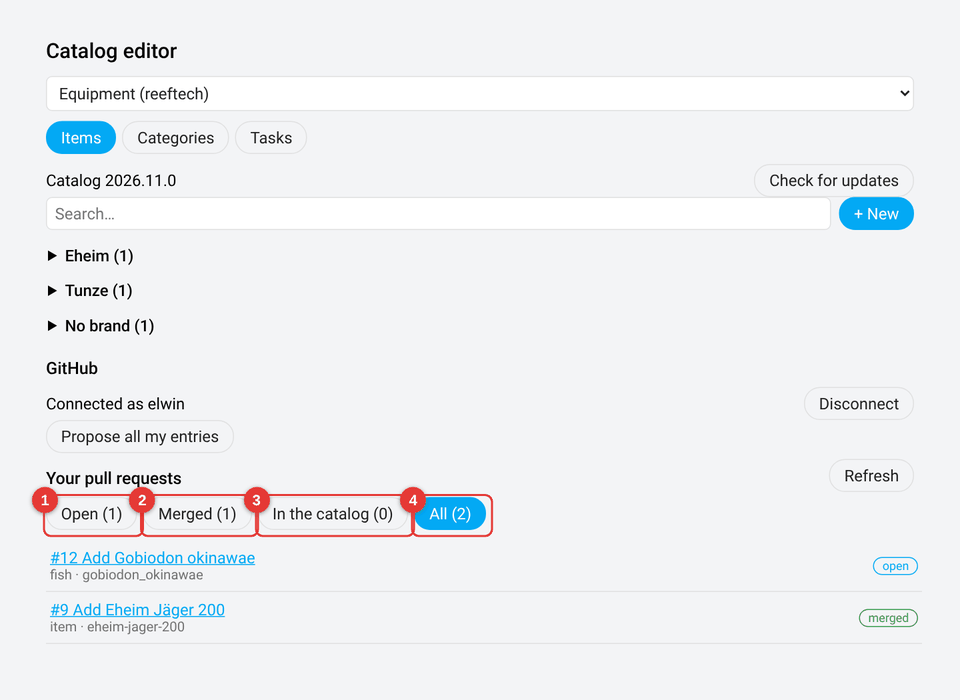

# Guia do utilizador — Editor de catálogo

[English](guide.en.md) · [Français](guide.fr.md) · [Deutsch](guide.de.md) · [Español](guide.es.md) · [Italiano](guide.it.md) · [Nederlands](guide.nl.md) · [Polski](guide.pl.md) · **Português**

O editor de catálogo é um cartão do Home Assistant que permite **consultar, editar e criar** as fichas dos catálogos ReefTech (equipamentos, suplementos…), da vista da casa (árvores, objetos) e do ReefTank (peixes, corais, plantas, invertebrados), e depois **propô-las** à comunidade.

## 1. Para que serve o editor?

Imagine um ficheiro de fichas: uma ficha por aquecedor, suplemento, peixe ou árvore. O editor é o cartão que lhe permite lê-las, corrigir uma ou acrescentar uma nova, diretamente a partir do painel, sem tocar em nenhum ficheiro.

Três ideias a reter:

1. **O que guarda fica utilizável de imediato** em sua casa: a ficha vai para a sua «camada de utilizador», partilhada por todas as integrações que leem o catálogo.
2. **Propô-la ao catálogo é um passo adicional e opcional**: o editor abre por si um *pull request* (um pedido de inclusão) no GitHub, para que a sua ficha beneficie todos.
3. **O editor verifica as suas fichas** com as mesmas regras do catálogo: se disser «Everything checks out», a ficha será aceite.

## 2. Antes de começar

### Instalar e adicionar o cartão

1. Instale a integração *Catalog editor* (repositório personalizado do HACS, ou copiando a pasta `custom_components/catalog_editor`) e adicione-a em *Definições → Dispositivos e serviços*.
2. A integração pede o **ID de cliente de uma aplicação OAuth do GitHub** (ver abaixo) e os **catálogos a subscrever** (equipamentos, suplementos, parâmetros, testes de água, árvores, objetos e as espécies do ReefTank: peixes, corais, plantas, invertebrados). Tudo vem marcado por predefinição; pode alterá-lo mais tarde em *Configurar*.
3. Num painel, adicione um cartão manual com este código:

```yaml
type: custom:catalog-editor-card
```

O cartão é servido pela integração: não há nada a acrescentar aos recursos. É apresentado em francês ou inglês, conforme o idioma do Home Assistant.

### Criar a aplicação do GitHub (uma só vez, 1 minuto)

Este passo só é necessário se quiser **propor** fichas ao catálogo. Para editar em sua casa pode ignorá-lo.

1. Abra <https://github.com/settings/applications/new> (com a sessão do GitHub iniciada).
2. *Application name*: o que quiser, por exemplo `Catalog editor`. *Homepage URL* e *Authorization callback URL*: qualquer endereço, por exemplo `https://github.com/Elwinmage/catalog-editor` (não são usados).
3. Marque **Enable Device Flow** e depois **Register application**.
4. Copie o **Client ID** da página seguinte para a integração. Não é preciso nenhum segredo.

## 3. Primeiro arranque: descarregar um catálogo

Na primeira vez, o catálogo ainda não está no seu Home Assistant. O cartão avisa: *«This catalog is not downloaded yet»*.


1. Clique em **Download** (1): o cartão obtém a última versão publicada do catálogo.
2. Para mudar de catálogo, abra a **lista pendente** (2) no topo. Cada nome é seguido da sua família: *(reeftech)*, *(reeftank)* ou *(house view)*.

O catálogo descarregado é partilhado com as outras integrações instaladas: um só download para todos. Mais tarde, **Check for updates** obtém uma versão mais recente.

> Se faltar um catálogo na lista, é porque não está subscrito. Adicione-o em *Configurar*, na integração.

## 4. Visita ao ecrã

Este é o ecrã inicial. As marcas vermelhas correspondem à lista abaixo.


1. **O catálogo**: a lista pendente escolhe aquele que consulta.
2. **O tipo de ficha**: um catálogo contém vários (aqui Items, Categories, Tasks).
3. **A pesquisa**: escreva algumas letras e a lista reduz-se logo.
4. **+ New**: cria uma ficha vazia.
5. **Check for updates**: obtém uma nova versão do catálogo.

Sob a lista, duas zonas dizem respeito ao GitHub: a **ligação** e os seus **pull requests** (secções 8 e 9). Cada linha tem uma etiqueta: *catalog* para uma ficha oficial, *yours* para uma ficha guardada em sua casa.

## 5. Encontrar uma ficha

- **Pela pesquisa**: escreva parte do nome ou do identificador. Se nada corresponder, o cartão mostra «Nothing here yet».
- **Pela marca**: no catálogo de equipamentos, as fichas estão agrupadas (Eheim, Tunze, sem marca…). Clique na seta de um grupo para o abrir.
- **Pelo tipo de água**: nos catálogos de espécies do ReefTank — **peixes, corais, plantas e invertebrados** — botões filtram a lista: *All waters*, *Marine*, *Freshwater*, *Brackish*. O número entre parênteses é a quantidade de fichas.


As plantas e os invertebrados encontram-se exatamente da mesma maneira:


Para abrir uma ficha, basta clicar na sua linha.

## 6. Editar ou criar uma ficha

O formulário é gerado a partir das regras do catálogo: um campo acrescentado ao catálogo aparece aqui sem atualizar o cartão.

- Os campos marcados com uma **estrela vermelha** são obrigatórios.
- Numa ficha **do catálogo**, um aviso lembra que guardá-la cria **a sua própria versão**: o original nunca é alterado.
- **Identificador**: proposto automaticamente (minúsculas, algarismos, `-` e `_`). Para uma espécie, é o nome científico (`genero_especie`). Pode corrigi-lo.
- **Nomes em vários idiomas**: preencha pelo menos o inglês. *Other languages* abre os restantes; o botão **Translate** preenche os que faltam por si.
- **Caixas e listas**: tipos de água, compatibilidade com recife… conforme a ficha. Uma cor (árvores, objetos) escolhe-se com o seletor ou escreve-se como `#rrggbb`.

Sob o formulário, uma mensagem indica o estado da ficha: **«Everything checks out»** a verde, ou a lista do que há a corrigir. Enquanto houver um erro, os botões de guardar ficam esbatidos.

### O que muda consoante o catálogo

| Catálogo | Imagem da ficha |
| --- | --- |
| Equipamentos, suplementos, parâmetros, testes de água, árvores, objetos | Um bloco **Image** permite enviar uma imagem (convertida em WebP transparente) |
| **Peixes** | Sem imagem para enviar: constrói-se uma **animação** (secção 7) |
| **Corais, plantas, invertebrados** | O editor altera a **descrição** da espécie. As suas imagens são construídas com as ferramentas do catálogo ReefTank (ver o respetivo README): este formulário não tem bloco de fotografia |


## 7. Peixes: fotografia e animação

No aquário do ha-reef-card, um peixe pode ser mostrado em **três níveis de renderização**. É a chave para perceber o que o editor faz:

| Nível | O que se vê | De onde vem |
| --- | --- | --- |
| **1. Peixe genérico** | Um peixe «para todo o serviço», o mesmo para todas as espécies em causa | Sem imagem na ficha: é o valor por omissão do catálogo (`unknown_fish`) |
| **2. Animação a partir de uma fotografia** («degraded») | O peixe verdadeiro, com uma animação simples: nadar, repouso, inversão | **Construída pelo editor** a partir de uma fotografia (gerada por IA ou sua) |
| **3. Animação a partir de vídeos** («real») | O peixe verdadeiro, com uma animação fluida e natural | Construída **fora do editor**, com as ferramentas do catálogo ReefTank, a partir de clipes de vídeo curtos (Kling, Veo…) |

O editor serve, portanto, para passar do nível 1 ao nível 2, depressa e sem vídeo. O nível 3 continua a ser o objetivo final: quando existe, **nunca é substituído** por uma animação feita a partir de uma fotografia, a não ser que marque *«Use it anyway (ignore the checks)»*. Inversamente, uma animação de nível 2 destina-se a ser um dia substituída por uma verdadeira.

O bloco *Photo and animation* indica sempre em que ponto está a ficha: *«This species has no picture yet»* (nível 1), *«Its animation was made from a photo…»* (nível 2) ou *«Its animation was made from videos: a photo does not replace it»* (nível 3).

### Passo 1 — Preparar a fotografia

O bloco *Photo and animation* encontra-se sob o formulário da espécie. As marcas vermelhas correspondem a:


1. **Species in the prompt**: o nome científico usado para pedir a imagem (já preenchido).
2. **Background colour**: magenta ou verde. Escolha a que mais contrasta com a espécie (nada de magenta para um peixe rosa).
3. **Show the prompt**: mostra o texto exato que será enviado, para o copiar para qualquer outra ferramenta de imagens.
4. **Generate the photo**: pede a imagem ao seu fornecedor de IA. Escolha primeiro o fornecedor (Google Gemini, OpenAI ou Cloudflare Workers AI) e introduza **a sua própria chave de API** nas *Opções* da integração. A chave fica no Home Assistant e nunca é devolvida ao cartão. Sem chave, este botão não aparece.
5. **A sua própria fotografia**: pode também enviar um ficheiro (PNG, JPEG ou WebP). Indique então o autor e a licença.
6. **Play the animation**: abre a pré-visualização (passo 3). O botão só aparece se a ficha já tiver uma animação ou se acabou de construir uma.

A fotografia deve mostrar **um único peixe, de perfil, com a cabeça para a direita**, sobre um fundo liso.

### Passo 2 — Verificar a fotografia e construir a animação

Depois de gerada, a fotografia aparece em miniatura com a sua origem (modelo usado, dimensões). O editor **verifica-a**: fundo liso, peixe inteiro sem corte na margem, tamanho suficiente. Se for recusada, o cartão explica porquê: gere de novo ou mude a cor de fundo.


Se a fotografia for aceite, clique em **Build the animation**. A mensagem *«Animation ready: it is attached when you save the entry»* confirma que está tudo bem.

### Passo 3 — Ver a animação

**Play the animation** abre um painel ao lado do formulário. Encadeia em ciclo quatro sequências: **stay** (parado), **swim** (nadar), **turn** (inversão) e depois a inversão **em espelho**, para que o peixe volte a olhar para onde começou. O nome da sequência em curso aparece acima do peixe. *Close* fecha o painel.

A lista **Background** permite avaliar o resultado sobre três fundos: **Water**, **Dark** e **Light**.


> As capturas deste guia mostram um peixe desenhado para o exemplo: a animação real segue a fotografia da sua espécie.

## 8. Guardar e propor ao catálogo

### Guardar em sua casa

**Save** coloca a ficha na sua camada de utilizador, partilhada por todas as integrações: fica utilizável **de imediato**, sem esperar por uma publicação. Para uma ficha do catálogo, é uma cópia local (uma *substituição*): mantém a imagem original enquanto não enviar uma nova.

### Ligar ao GitHub (uma vez)

1. Clique em **Connect to GitHub** na zona do GitHub.
2. O cartão mostra um **código** (do tipo `ABCD-1234`) e um endereço do GitHub.
3. Abra o endereço, escreva o código e confirme.
4. O cartão deteta a ligação sozinho e mostra *«Connected as …»*.


O editor só pede a permissão `public_repo`: faz um fork do catálogo, envia um ramo e abre o pull request. O token fica guardado no Home Assistant. **Disconnect** apaga-o.

### Propor

1. Verifique se a mensagem diz **«Everything checks out»**.
2. Marque a caixa de **certificação**: declara que qualquer imagem é obra sua (ou que detém os direitos) e aceita que seja publicada sob licença CC BY 4.0.
3. Clique em **Save and propose to the catalog**. O botão fica esbatido enquanto não estiver ligado, a ficha tiver um erro ou a caixa não estiver marcada.


O cartão mostra então o número do pull request aberto. Se guardar de novo enquanto está aberto, é acrescentado um novo commit. Para um peixe, o pedido contém a animação e a sua miniatura, **nunca a fotografia**.

**Propose all my entries** envia de uma só vez todas as suas fichas locais ainda não propostas. Se pertencerem a vários catálogos, é aberto um pull request por repositório.

## 9. Acompanhar os seus pull requests

Na parte inferior do cartão, **Your pull requests** lista o que propôs. Quatro botões filtram a lista (o número indica quantos pedidos há):



| Filtro | O que mostra |
| --- | --- |
| Open | Pedidos à espera de revisão (vista predefinida) |
| Merged | Aceites, mas ainda não numa versão publicada do catálogo |
| In the catalog | Aceites e publicados numa versão |
| All | Tudo, incluindo os pedidos recusados (assinalados com um distintivo) |

Clique no número de um pedido para o abrir no GitHub. **Refresh** recarrega a lista.

Quando o seu pedido é integrado **e** publicado, a sua cópia local é removida automaticamente se for idêntica à ficha do catálogo. Caso contrário, fica: apague-a à mão a partir da ficha.

## 10. Perguntas frequentes

| Sintoma | Causa provável | O que fazer |
| --- | --- | --- |
| Falta um catálogo na lista | Não está subscrito | *Configurar* na integração, marque-o (ela recarrega) |
| Não existe o botão «Generate the photo» | Nenhum fornecedor de imagens configurado | Escolha um fornecedor e introduza a chave nas opções; ou envie a sua própria fotografia |
| A fotografia é recusada | Fundo não liso, peixe cortado ou demasiado pequeno | Gere de novo ou mude a cor de fundo |
| Não é possível substituir uma animação | A ficha já tem uma animação feita a partir de vídeos (nível 3) | É propositado. Marque *«Use it anyway»* só se tiver a certeza |
| «Save and propose» está esbatido | Sem ligação, erro na ficha ou certificação por marcar | Corrija a ficha, ligue-se, marque a caixa |
| A ligação ao GitHub expirou | Token revogado ou expirado | Clique de novo em *Connect to GitHub*; a proposta em curso retoma após a ligação |
| O cartão não se atualiza | Cache do navegador | Recarregue a página (Ctrl+F5); podem ser precisos vários recarregamentos |

Uma ficha que guarda é uma **cópia local**: para a remover, abra-a e use o botão de eliminar.
